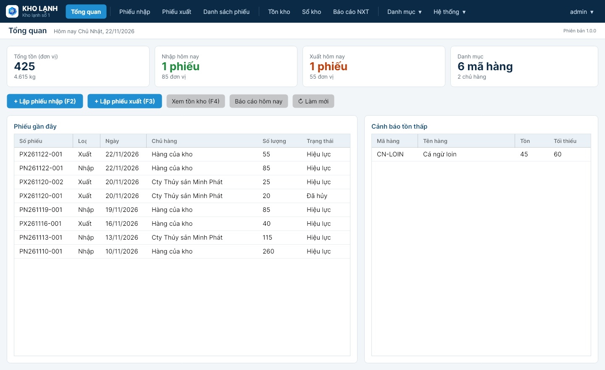

# Kho Lạnh C#

Phần mềm quản lý kho lạnh chạy trên Windows, viết bằng C# (.NET 8, giao diện Avalonia), dữ liệu SQLite cục bộ.
Đây là phần mềm **mới, tách riêng**: không dùng chung dữ liệu và không ảnh hưởng tới phần mềm kho cũ.



## Tính năng (bản 1.0)

| Nhóm | Chức năng |
|---|---|
| Tài khoản | Đăng nhập, 3 vai trò: **Quản trị** (toàn quyền), **Quản lý** (sửa danh mục, hủy phiếu, sao lưu), **Nhân viên** (lập phiếu, xem tồn, báo cáo). Lần chạy đầu tạo tài khoản Quản trị. |
| Danh mục | Mã hàng (nhóm, đơn vị, kg/đơn vị, size, tồn tối thiểu), nạp / xuất Excel. Chủ hàng (hàng của kho, hàng khách gửi). |
| Phiếu | Phiếu nhập, phiếu xuất theo mã hàng + size + lô + vị trí, số lượng và số kg. Số phiếu tự tăng theo ngày (`PN261122-001`, `PX261122-001`). Chặn xuất quá tồn của đúng lô / vị trí. Hủy phiếu có lý do (không xóa). In phiếu A4. |
| Tồn kho | Tồn chi tiết theo chủ hàng / mã / size / lô / vị trí, số ngày lưu kho; tổng theo mã, cảnh báo tồn thấp. |
| Báo cáo | Sổ kho (thẻ kho có tồn lũy kế), báo cáo nhập – xuất – tồn theo khoảng ngày (chọn 1 ngày = báo cáo hằng ngày). Tất cả xuất được Excel. |
| An toàn | Tự sao lưu mỗi ngày (giữ 30 bản), sao lưu ra file, khôi phục (tự giữ bản trước khi khôi phục), nhật ký thao tác. |

Phím tắt: **F2** phiếu nhập · **F3** phiếu xuất · **F4** tồn kho · **Ctrl+S** lưu phiếu · **Enter** thêm dòng.

## Cài đặt và chạy

1. Tải `KhoLanh.exe` ở mục **Actions › Build KhoLanh.exe › Artifacts** (hoặc **Releases** nếu có).
2. Chép vào một thư mục bất kỳ, nhấp đúp để chạy. Không cần cài .NET.
3. Lần đầu: tạo tài khoản Quản trị, rồi vào **Danh mục › Mã hàng** để thêm hoặc nạp mã hàng từ Excel.

Windows SmartScreen có thể cảnh báo vì file chưa ký số: bấm **More info › Run anyway**.

## Dữ liệu nằm ở đâu

`%LOCALAPPDATA%\KhoLanhCS\`
- `khodata.db` — toàn bộ dữ liệu (SQLite)
- `SaoLuu\` — bản sao lưu tự động hằng ngày
- `In\` — các phiếu đã in (HTML)

Muốn đặt dữ liệu ở chỗ khác (ví dụ ổ D), đặt biến môi trường `KHOLANH_DATA=D:\KhoLanhData` trước khi chạy.

## Dành cho lập trình viên

```
src/KhoLanh.Core      nghiệp vụ + SQLite (Dapper), xuất Excel (ClosedXML), mẫu in
src/KhoLanh.App       giao diện Avalonia
tests/KhoLanh.Core.Tests  kiểm thử xUnit cho nghiệp vụ
tools/Screenshots     tạo dữ liệu mẫu và chụp ảnh các màn hình (chạy không cần màn hình)
```

```bash
dotnet test tests/KhoLanh.Core.Tests
dotnet run --project src/KhoLanh.App
dotnet publish src/KhoLanh.App -c Release -r win-x64 --self-contained true -p:PublishSingleFile=true -p:IncludeNativeLibrariesForSelfExtract=true -o publish/win-x64
dotnet run --project tools/Screenshots -- docs/anh
```

Mỗi lần đẩy lên nhánh `main`, GitHub Actions tự chạy kiểm thử và đóng gói `KhoLanh.exe`. Gắn tag `v1.0.0` để tạo bản phát hành.
