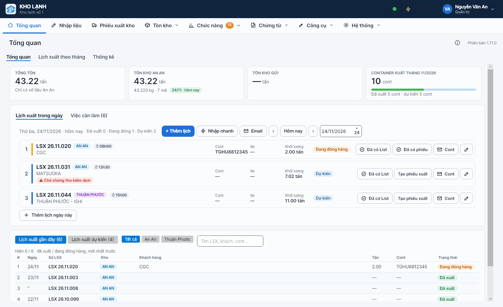
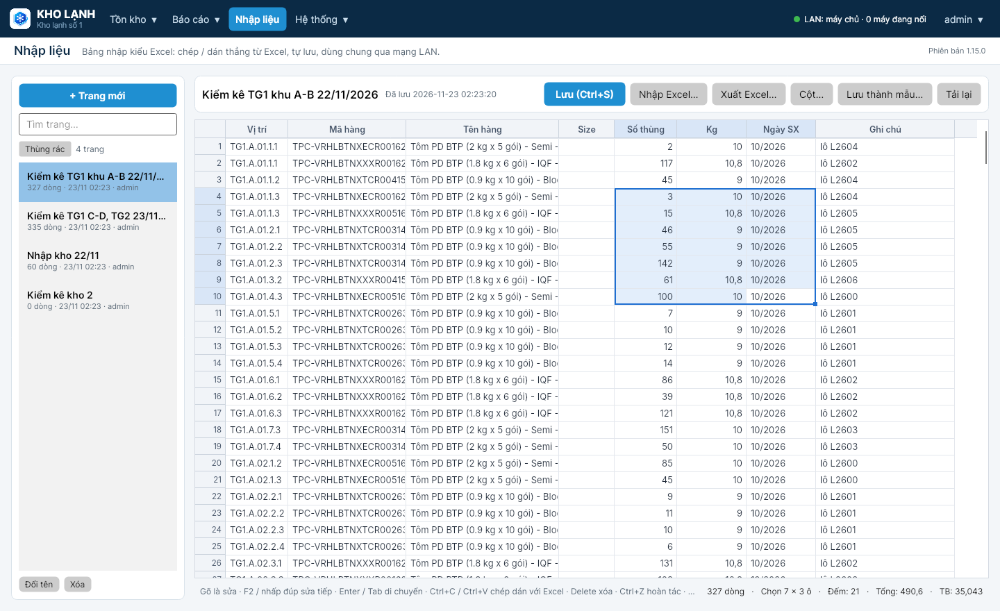
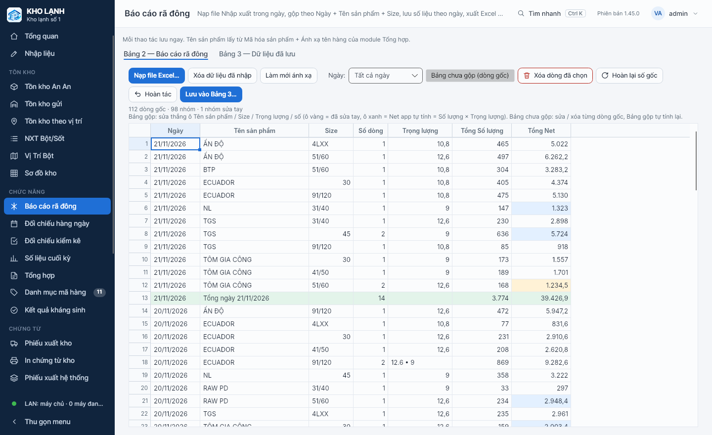
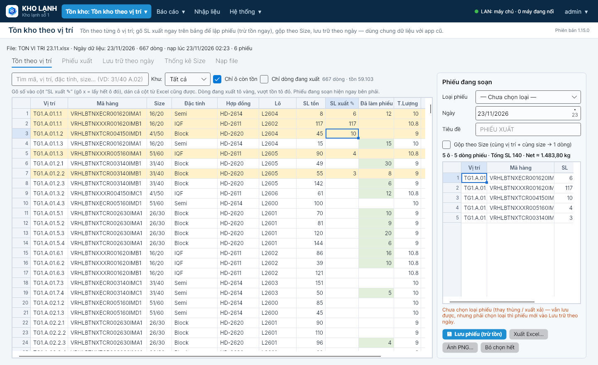
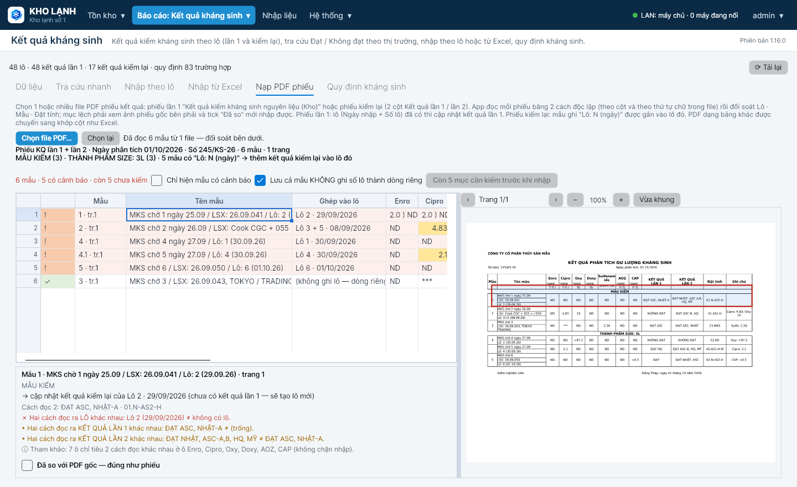

# Kho Lạnh C#

Phần mềm quản lý kho lạnh chạy trên Windows, viết bằng C# (.NET 8, giao diện Avalonia), dữ liệu SQLite cục bộ.
Đây là phần mềm **mới, tách riêng**: không dùng chung dữ liệu và không ảnh hưởng tới phần mềm kho cũ.



## Đồng bộ qua Google Drive

Máy ở mạng khác (không nối LAN) tải dữ liệu từ máy chính qua thư mục Google Drive, có thể gửi thay đổi ngược lên (ban ngày LAN ở công ty, ban đêm máy ở nhà làm độc lập; sao lưu tự động lên Drive mỗi ngày, khôi phục máy ở nhà, khóa gửi lên theo tài khoản) — xem [docs/DONG-BO-GOOGLE-DRIVE.md](docs/DONG-BO-GOOGLE-DRIVE.md).

## Máy chủ trên Google Cloud

Máy chủ LAN chạy không giao diện (`src/KhoLanh.Server`, Linux), kênh mã hóa AES-GCM — xem [docs/MAY-CHU-GOOGLE-CLOUD.md](docs/MAY-CHU-GOOGLE-CLOUD.md), file triển khai trong `deploy/`.

## Module hiện có

App đang được dựng lại theo từng module (từ bản 1.7.0 đã gỡ các module phiếu / tồn / sổ kho / báo cáo / danh mục của bản 1.0).

| Nhóm | Chức năng |
|---|---|
| Tổng quan · Lịch xuất | **Trang đầu tiên khi mở app** (theo Trang Chủ + Lịch xuất khẩu của app cũ, giao diện riêng C#), dùng chung database `lichxuat` với app cũ / điện thoại (LichXuatCont · TongKetThang · LX_ViecChuaLich · LX_TuDong). 4 thẻ: Tổng tồn · Tồn kho An An · Tồn kho gửi (kèm ngày dữ liệu, cũ ≥ 2 ngày báo vàng) · Container xuất tháng này (đã xuất / dự kiến; LSX chung cont tính 1). **Lịch xuất trong ngày** (lùi / tới / chọn ngày): mỗi container 1 thẻ — LSX, công ty An An / Thuận Phước, khách, giờ kéo đóng, việc cần làm, số cont, số xe (từ phiếu), tấn, trạng thái; nút **Tạo List** (từ tồn kho Thành Phẩm Chính theo cột Hợp đồng "26.11.020-17/11": ngày × size, MKS theo Đặc tính) / **Tạo phiếu xuất** (điền LSX, ngày, khách, số cont, áp List) — đã có thì thành nút mở thẳng List / phiếu; **✉ Cont** (dán email Thông tin xe → số cont); ✎ Sửa. **+ Thêm lịch** (tự dò Thành Phẩm Chính: khách, thị trường, hàng, size, tồn, tấn; chặn trùng LSX cùng ngày; chung container), **⚡ Nhập nhanh** (dán kế hoạch "Ngày 24/11: Xuất LSX 26.07.051 + 26.08.033; LSX 26.10.054" → xem trước → thêm), **✉ Email**: đọc Gmail bằng IMAP (mật khẩu ứng dụng, mã hóa trên máy, chỉ đọc), thư gốc có LSX trên tiêu đề = tạo lịch (ngày ETD), thư trả lời = đổi / hủy lịch (chỉ câu nói về kéo đóng / xuất hàng), thư «Thông tin xe» tự ghi số cont vào lịch và thông tin xe vào phiếu; thư của **người gửi tin cậy** qua lưới an toàn thì tự áp, còn lại chờ duyệt (sửa ngày / giờ, duyệt, bỏ qua, hoàn tác), tab Thử đọc thư, tự quét theo chu kỳ. Lịch xuất gần đây / dự kiến (lọc An An / Thuận Phước, tìm), **Việc cần làm** (việc đến hạn / quá hạn của từng LSX, chuẩn bị còn thiếu List · Phiếu · Cont cho hôm nay / ngày mai, việc cho LSX chưa có lịch — tự chuyển vào lịch khi có), **Thao tác nhanh** chọn theo tài khoản. Chi tiết lịch: chuẩn bị, hàng theo tồn kho, việc cần xử lý (tick, hạn mặc định trước ngày xuất 1 ngày, gợi ý việc hay dùng), chuyển ngày, đổi trạng thái, dò lại tồn. Tab **Lịch xuất theo tháng** và **Thống kê** (cont / tấn theo tháng, An An / Thuận Phước, khách nhiều nhất). Lịch ngày đã qua tự "Đã xuất". Quyền: "Tổng quan · Lịch xuất" (Xem / Sửa), "Duyệt email Lịch xuất". |
| Tồn kho An An | **Viết bằng C# (không WebView2)**, dùng chung database `ton-kho-an-an` với app cũ: 6 tab (Load Data, Phân Loại 8 nhóm, Báo Cáo, Theo Dõi Tồn, Đặc Tính, Tổng Hợp). Nạp file xlsx / xls / csv có bước xem trước và kiểm tra, lịch sử nạp + hoàn tác, so sánh 2 lần nạp; phiếu Xuất Hàng (ghi nhận rồi mới trừ tồn), Kho Gửi lấy từ Tồn kho gửi, 15 loại file Excel xuất ra. Bản WebView2 cũ vẫn còn ở mục “Tồn kho An An (bản cũ)” để đối chiếu. Chưa so lại với dữ liệu thật ở bản này (xem docs/BAN-GIAO.md). |
| Tồn kho gửi | **Viết bằng C# (không WebView2)**, dùng chung database `ton-kho-gui` với app cũ: 7 tab (Load Data, Dữ Liệu, Phiếu Xuất, Phân Loại 6 nhóm + Điều kiện lọc, Đặc Tính, Báo Cáo — Bảng Tổng Hợp, Đối Soát). Nạp file xlsx / xls / csv có xem trước + kiểm tra, lịch sử nạp + hoàn tác; phân loại theo Số lô / Size (Ecuador, Ấn Độ, Gia Công, Giám Sát, Nguyên Liệu, HLSO) kèm điều kiện lọc tự thêm; Đặc Tính suy từ Tên hàng + bảng nhập tay + chuyển Số lô CKQ + gộp nhóm; phiếu xuất (tạo / sửa / xóa, trừ và hoàn Số kiện + Trọng lượng, phiếu đợt cũ bị khóa) xuất Excel “Phiếu yêu cầu xuất hàng”; xuất Excel Dữ Liệu / từng nhóm / Bảng Tổng Hợp. Bản WebView2 cũ còn ở mục “Tồn kho gửi (bản cũ)” để đối chiếu. Bảng Tổng Hợp Tùy Chọn ở tab Báo Cáo (chọn Size / Đặc Tính, ẩn cột trống, lưu mẫu, xuất Excel). Chưa so với dữ liệu thật. |
| NXT Bột/Sốt | Viết bằng C#, theo "Sổ kho bột / sốt" của app cũ, dùng chung database `nxt-bot-sot` (sổ cái `SoCai`, `SoKhoDinhMuc`, `SoKhoSanLuong`, `SoKhoCauHinh`, `_SoKhoLichSu`). Mọi nghiệp vụ là dòng sổ cái (tồn đầu · nhập · xuất · chuyển · điều chỉnh); tồn theo lô (vị trí · mã · size · hạn dùng · ngày nhập), xuất không chỉ định lô thì trừ **FIFO**, mốc tồn đầu. 8 tab: Phiếu nhập · Phiếu xuất · Chuyển vị trí (soạn trên lưới, kiểm tra, cảnh báo tràn lô / vượt định mức, in A4) · Tồn kho (theo mã + size / vị trí / lô / NXT kỳ / sắp hết hạn / tồn âm, chốt tồn đầu kỳ, xuất Excel) · Kiểm kê (số đếm → chênh → ghi điều chỉnh) · Định mức (định mức + sản lượng LSX → báo cáo vượt / thiếu, LSX chưa có định mức) · Sổ cái & lịch sử (lọc, xóa, nạp / xuất Excel, hoàn tác từng thao tác) · Cấu hình (dung sai, báo hạn, tồn tối thiểu). Lõi đối chiếu khớp tuyệt đối với lõi JS app cũ. Quyền "NXT Bột/Sốt". Chưa làm: mẫu cột `SoKhoMau`, đẩy tồn lên Vị Trí Bột (module sau). |
| Vị Trí Bột | Viết bằng C#, theo "Vị Trí Bột" (M01VTB) của app cũ, dùng chung database `ton-kho-an-an` (sheet `ViTriBotMeta`, `ViTriBot`, `ViTriBotPhieuDienThoai`). Tồn bột / sốt theo vị trí được **đưa lên từ NXT Bột/Sốt › Tồn kho › "📱 Đưa lên Vị Trí Bột…"** (tồn cuối theo vị trí đến ngày chọn, thay toàn bộ dữ liệu cũ; phiếu đợt cũ bị khóa). Bảng tồn bỏ dòng SL = 0, tìm không dấu; gõ SL xuất ngay trên lưới ("x" = lấy hết) → "Tạo phiếu xuất" lưu và trừ ngay cột SL; danh sách phiếu PC / điện thoại: hủy trừ / trừ lại / xóa (hoàn SL). Quyền "Vị Trí Bột". Chưa làm: nhận phiếu từ điện thoại (để dành khi làm bản điện thoại). |
| Tồn kho theo vị trí | Viết bằng C# (không WebView2), theo “Tồn Vị Trí An An” của app cũ, dùng chung dữ liệu (db `ton-vi-tri-an-an`). Nạp file Tồn kho theo vị trí (tự tìm dòng tiêu đề), tìm nhanh + lọc theo khu. Gõ / dán SL xuất ngay trên lưới (“x” = lấy hết ô), khung “Phiếu đang soạn” bên phải: loại phiếu (thay thùng / xuất xả), ngày, tiêu đề, gộp theo Size, cảnh báo (còn hàng ở vị trí khác, SL bất thường, trùng phiếu cùng ngày). Lưu phiếu trừ tồn ngay; sửa, hủy trừ / trừ lại, gộp / tách phiếu, tách mã ra phiếu mới, đổi loại / ngày, xóa (hoàn tồn), mở khóa phiếu đợt nạp cũ. Nạp file mới: đối chiếu phiếu đã trừ với file mới (khớp / chưa giảm / lệch), trừ lại phiếu hôm nay, liệt kê hàng đổi vị trí. Lưu trữ theo ngày (gộp theo ngày + loại), thống kê Size, xuất Excel theo mẫu cũ và ảnh PNG. In trực tiếp (nút 🖨 In: mở trang in A4 trong trình duyệt, In hoặc Lưu PDF) cho phiếu đang soạn / đã lưu / lưu trữ theo ngày. Chưa làm: nhận phiếu từ điện thoại. |
| Sơ đồ kho | Viết bằng C# (không WebView2), theo “Sơ đồ kho” của app cũ, dùng chung dữ liệu (db `so-do-vi-tri`; tồn đọc từ Tồn kho theo vị trí, vị trí dạng `TG1.A.01.1.1` = Kho.Khu.Dãy.Tầng.Khoang). Sơ đồ trực quan từng dãy (tầng × khoang, tầng cao ở trên), tô màu trống / có hàng / nhiều mã / tầng vượt mức, cột mức đầy pallet từng tầng, tìm và tô sáng ô trên sơ đồ; bấm ô xem hàng, pallet tầng, gợi ý chuyển khi tầng vượt mức. Danh sách vị trí có lọc (trạng thái, dãy, tầng, khoang), hàng chưa có vị trí (khu Z), quy cách kiện / gói (sửa trên lưới, điền theo tên hàng loạt), mã rút gọn / mã 21 ký tự. Phiếu In vị trí (theo sổ sách hoặc phiếu trống, sửa trên bảng, gộp size, chuyển đề xuất, hoàn tác, xuất Excel A4), chuyển sang Nhập liệu (mẫu Kiểm kê) và rà soát chênh lệch, khóa kiểm kê theo kho / khu / dãy kèm xem thay đổi, cấu hình kho (dãy, khoang, tầng, dãy khác tầng), xuất Excel. In trực tiếp (🖨 In) danh sách vị trí và Phiếu In vị trí (mỗi dãy 1 trang A4, In hoặc Lưu PDF). |
| Đối chiếu kiểm kê | Viết bằng C# (không WebView2), theo “Số liệu kiểm kê” của app cũ (db `so-lieu-kiem-ke`). Số kiểm kê lấy từ các trang Nhập liệu mẫu Kiểm kê (chọn trang của kỳ, tự bỏ lần đếm cũ khi một vị trí đếm 2 ngày, xem chi tiết hoặc gộp theo mã). Đối chiếu với Tồn kho An An (hiện tại hoặc bản chụp tồn) theo mã, theo kiện và kg: Khớp / Thừa / Thiếu / Lệch kg / Chỉ có ở kiểm kê / Chưa kiểm kê, lọc nhanh, chi tiết từng dòng, gợi ý nguyên nhân (gõ sai mã, lệch trọng lượng, đếm trùng, lệch kiện) và sửa mã sai thẳng vào trang Nhập liệu. Đối chiếu Kế toán: dán từ Excel hoặc nạp file (Mã hàng, Tên, Trọng lượng, Số lượng, Net) rồi so theo kg. Theo vị trí: tô màu trên Sơ đồ kho (chưa đếm / khớp / lệch / thừa hàng) so với Tồn kho theo vị trí theo mã + lô, tiến độ từng kho / khu / dãy. Lệnh đếm theo dãy chia đều cho người đếm, xuất phiếu đếm Excel. Chốt kỳ kèm lý do (lưu bản chốt có số phiên bản, khóa thay đổi tới khi hủy chốt), xuất báo cáo Excel. Phân loại nhóm tồn theo module Tồn kho An An (Thành Phẩm Chính / Tạm / BM / HLSO / Gia Công / Nhập Khẩu / Nguyên Liệu / Giám Sát — đọc cả chuyển thủ công và điều kiện tự thêm), cột + lọc theo nhóm, ghi chú mã nằm nhiều nhóm; so theo LSX cho Thành Phẩm Chính (Khớp / Lệch / Thiếu thông tin, lọc “Lệch theo LSX”). Phát sinh nhập / xuất ghi ngay trên trang Nhập liệu (cột Ngày xuất / SL xuất / Ngày nhập / SL nhập) được quy số đếm về **Ngày chốt tồn** (cùng hoặc sau ngày đếm → trừ / cộng; trống ngày, trước ngày đếm, xuất quá số có → báo cần rà; sau ngày chốt → chỉ ghi nhận), hiện trong chi tiết từng mã. Tab **Tồn kho gửi**: lấy từ module Tồn kho gửi, đổi mã kho gửi 18–19 ký tự sang mã 21 (bảng chuyển đổi dùng chung với app cũ, không có thì tự đổi theo Mã hóa sản phẩm), cộng vào đối chiếu Kế toán (Tổng = kiểm kê + kho gửi); mã chỉ có ở kho gửi không lẫn vào đối chiếu An An. File Excel báo cáo có cột phát sinh nhập / xuất và sheet “Kho gui”, “Phat sinh”. |
| Số liệu cuối kỳ | Viết bằng C#, theo "Đối chiếu kế toán - kho" (M07) của app cũ, dùng chung database `so-lieu-cuoi-ky` (sheet DC2_*). Đối chiếu **tồn cuối kỳ theo mã (kg)**: Tồn kho = Tồn An An + Tồn kho gửi; Chênh lệch = Tồn kho − Kế toán. Nạp file Excel An An / Kế toán (sheet NXT + sheet chứng từ + danh mục thành phẩm) / Kho gửi (tiêu đề 2 tầng, mã 18–19 ký tự tự đổi sang 21) — tự nhận cột (nhớ theo tên cột), không chắc thì cho ánh xạ cột tay; kỳ đọc từ nội dung báo cáo. Mỗi mã lệch: nguyên nhân gắn nhãn **xác định / nghi ngờ** + độ tin cậy (chỉ có 1 bên, ngoài danh mục, nhầm mã / quy cách / chia mã, lệch đầu kỳ / phát sinh, chứng từ lệch NXT / bằng đúng chênh / trùng / ngoài kỳ, tự không khớp, sai Net, nhầm đơn vị, tồn âm…; không đủ bằng chứng → "Chưa xác định"), gợi ý mã nhầm (độ giống mã, 10 đoạn mã, tên, đối ứng số lượng), mã nghi ngờ xếp cạnh nhau, chứng từ có dấu hiệu. Xử lý: xác nhận nguyên nhân, sửa mã (chuyển kg ở kho hoặc kế toán), điều chỉnh, ghi chú, đánh dấu chứng từ, nạp file điều chỉnh, lịch sử + hoàn tác; nhiều máy cùng làm tự gộp. Xuất Excel 10 sheet. Lõi khớp tuyệt đối với lõi JS app cũ (test đối chiếu). Quyền "Số liệu cuối kỳ". |
| Tổng hợp | Viết bằng C# (không WebView2), dùng chung dữ liệu với app cũ (db `tong-hop`). Mã hóa sản phẩm 21 ký tự (10 tổ hợp, danh sách chuẩn), danh sách mã hàng (11.603 mã mặc định, tô đỏ mã sai độ dài, tô vàng mã trùng / tổ hợp chưa khai báo, ghép mã), Bảng 1 nhập từ Excel → Bảng 2 gộp theo Ngày + Tên sản phẩm + Size, ánh xạ tên hàng (quy tắc đơn, kết hợp). Tra cứu kháng sinh nay là module riêng “Kết quả kháng sinh”. |
| Kết quả kháng sinh | Viết bằng C# (không WebView2), theo “Tra cứu kháng sinh” của app cũ, db riêng `ket-qua-khang-sinh` (nút “Chép dữ liệu từ app cũ” lấy từ `tong-hop/KhangSinh`). Dữ liệu theo ngày, chế độ Lần 1 / Kiểm lại, ô tìm nhanh (lô, ngày, MKS / mẫu chờ), lọc theo cột, xóa theo dòng / ngày / phiếu / tháng, xuất Excel. Tra cứu nhanh 7 chỉ tiêu (chọn trường hợp khớp y như app cũ), nhập theo lô trên lưới (tự tính Kết quả + Ký hiệu), nhập từ Excel (mỗi sheet một ngày, tự đoán cột), Quy định kháng sinh 83 trường hợp sửa trên lưới. Nạp PDF phiếu kết quả lần 1 (Kho) và kiểm lại (MKS chờ) như app cũ: đọc mỗi phiếu bằng 2 cách độc lập (theo cột / theo thứ tự chữ) rồi đối soát Lô · Mẫu · Đặt tính, sửa tay trên lưới, ảnh trang PDF gốc bên cạnh có khung đúng hàng mẫu, mục lệch phải tick "Đã so" mới nhập; lần 1 cập nhật lô (Ngày nhập + Số lô), kiểm lại gắn vào lô theo "Lô: N (ngày)"; PDF dạng bảng khác chuyển sang khớp cột như Excel. Đọc PDF bằng PdfPig, vẽ trang bằng PDFium, cả hai gói sẵn trong exe. |
| Báo cáo rã đông | Viết bằng C# (không WebView2), dùng chung dữ liệu với app cũ (db `bao-cao-ra-dong`). Nạp file báo cáo kho (tự tìm dòng tiêu đề, bỏ tiền tố TPC-), Bảng 2 gộp theo Ngày + Tên sản phẩm + Size (Net thiếu tự tính, sửa tay, bảng chưa gộp, hoàn tác), Bảng 3 lưu theo ngày (thay thế / cập nhật giữ dòng sửa tay / cộng dồn, hoàn tác cập nhật), Excel năm theo mẫu, ảnh bảng ngày. Nút “Lấy từ Đối chiếu hàng ngày” (cập nhật Bảng 3 từ file Xuất rã đông đã liên kết) và “Kiểm ngày thiếu”. |
| Đối chiếu hàng ngày | Viết bằng C# (không WebView2), theo M16 của app cũ. Liên kết 3 file Excel trên máy (lưu theo tài khoản): Xuất thay thùng, Xuất rã đông (app ghi thẳng) và Xưởng (chỉ đọc, 2 sheet tự ghép theo số mã trùng). So theo Ngày + Mã (khớp / lệch / chỉ có ở Kho / chỉ có ở Xưởng / ghi 0), BTP / NL so nhanh theo Size + kg/thùng, gợi ý mã nằm nhầm file, nghi sai mã. Sửa SL Kho ngay trên lưới, chuyển mã giữa 2 file, thêm dòng, sửa mã / ngày, xóa, nạp file gốc của phần mềm kho (thêm ngày mới / thay ngày khác số); ghi file giữ nguyên mẫu (sửa XML trực tiếp, dòng tổng ngày = SUM), ghi cả 2 file hoặc không file nào, sao lưu 1 bản / ngày (giữ 7 ngày), lịch sử + hoàn tác. Sửa tay số Xưởng chỉ để đối chiếu. Xuất Excel kết quả. Tab **Xuất kiểm**: chọn file gốc của phần mềm kho → tách riêng dòng "Xuất kiểm hàng", gộp theo Ngày + Mã hàng thành danh sách rút gọn 8 cột, "Cập nhật tên hàng" (tra theo mã từ Danh sách mã hàng rồi Mã hóa sản phẩm, xem trước, chọn từng dòng, hoàn tác), xuất file rút gọn. Thêm cột Size vào file Kho (🔠, theo từ điển Mã hóa sản phẩm, xem trước rồi ghi; không đè ô đã có). File gốc nạp được cả .csv; tên + trọng lượng khi thêm dòng được tra thêm từ Tồn kho An An. Chưa làm (so với app cũ): “Nạp tạm”, đọc file gốc .xls (cần thêm thư viện đọc Excel cũ). |
| Phiếu xuất kho | Viết bằng C# (không WebView2), theo "Phiếu nhập/xuất kho" của app cũ, dùng chung dữ liệu (db `phieu-nhap-xuat`, sheet `PNX_Phieu`). **Phiếu xuất khẩu theo LSX** (nạp List sản xuất PDF / Excel, thống kê xuất khẩu theo tháng), tab **List sản xuất** (kho List theo LSX: tình trạng theo tồn Thành Phẩm Chính · số phiếu · lịch xuất — Chờ xuất / Hoàn tất / Hết tồn chưa có phiếu / Đã xuất mà tồn còn…; nạp nhiều file, ⟳ Quét tồn kho tự tạo List cho LSX còn tồn, xem ngày × size, gán Tên / Mã / Lô cho size, tạo phiếu từ List) **và Cargo list** cho Xuất Thuận Phước / Gia công / Gửi kho (mỗi cont = 1 Cargo + 1 phiếu: gõ Loại + Size-quy cách `0040-6` + Lô `22.05.26 L16` + số kiện từng dãy → tự ra mã hàng 25 ký tự và TRA kết quả kháng sinh theo ngày + lô, gom phiếu theo nhóm thị trường, đổ đầy từng dãy, dán thông tin xe, danh mục loại hàng / quy cách, xuất Excel theo mẫu thật). Soạn phiếu (mặt hàng × dòng DATE · size · kiện · MKS, NET theo quy cách `1.0 kg x 5 x 2` hoặc sửa tay), tự cấp số phiếu `NN.MM XKAA KK` theo tháng và hàng AA / TP, dán email "Thông tin xe" (tách 7 mục), nội dung email gửi kèm, xuất Excel `.xlsm` bằng cách điền thẳng vào file mẫu (giữ nguyên định dạng, hình, macro). Cargo list có dò tồn kho An An theo mã hàng (đủ tồn / vượt tồn / hết / không có mã + gợi ý mã gần giống, cảnh báo không chặn xuất). Tab Danh mục có “🪄 Gợi ý Mã gói + Tiền tố” cho quy cách mới (từ Mã hóa sản phẩm + Danh sách mã hàng). Các loại phiếu nhập / Xuất nội địa / chiếu xạ / khác: app cũ cũng chưa có mẫu Excel nên chưa làm. |
| In chứng từ kho | Viết bằng C#, theo "In chứng từ kho" của app cũ (db `in-chung-tu-kho`). Nạp Excel xuất kho (Xuất TBB / Xuất Xả / Xuất Kiểm, tự tìm dòng tiêu đề, nhận tiêu đề gần đúng), mỗi ngày chứng từ = 1 Phiếu xuất (DISPATCHING NOTE BM02/QT23), gộp nhiều ngày, tách dòng sang phiếu riêng cùng ngày, bổ sung tên hàng bị cắt từ mã 21 ký tự (Mã hóa sản phẩm), người ký, in / lưu PDF qua trình duyệt, xuất Excel theo mẫu. |
| Phiếu xuất hệ thống | Viết bằng C#, theo M09 của app cũ, chỉ đọc: gom phiếu xuất của Tồn kho An An, Tồn theo vị trí, Tồn kho gửi, NXT Bột/Sốt; lọc theo ngày / module / nguồn / người tạo, tìm cả mã hàng trong phiếu, xem chi tiết, xuất Excel. |
| Nhập liệu | Viết bằng C# (không WebView2). Các trang dạng lưới Excel: gõ / dán thẳng từ Excel (Ctrl+C / Ctrl+V), hoàn tác, điền xuống, tự lưu, mẫu cột (Nhập kho, Xuất kho, Kiểm kê, mẫu tự lưu), nhập / xuất Excel, thùng rác. Lưới dùng chung: `src/KhoLanh.App/Controls/SheetGrid.cs` + `src/KhoLanh.Core/Grid/GridModel.cs`. |
| Tài khoản | Đăng nhập (nhớ mật khẩu, tự đăng nhập; **Khởi động cùng Windows** — mọi tài khoản tự bật ở menu tài khoản hoặc Sao lưu và cài đặt: bật máy là phần mềm tự mở và vào thẳng, hợp cho máy chủ), 3 vai trò + phân quyền tới từng module. Dùng chung cho mọi máy qua Google Sheet: `docs/TAI-KHOAN-DUNG-CHUNG.md`. |
| Cập nhật | Tự kiểm tra GitHub Releases lúc mở app và mỗi 30 phút, tải ngầm, mở lại là dùng bản mới; quay lại bản trước. |
| An toàn | Tự sao lưu mỗi ngày (giữ 30 bản), sao lưu ra file, khôi phục, nhật ký thao tác. |
| Trợ lý hệ thống | Viết bằng C#, theo "Trợ lý hệ thống" của app cũ, **chỉ Quản trị**, chỉ đọc (Hệ thống › Trợ lý hệ thống). Quét nhanh / Quét sâu: lỗi phần mềm (đọc `logs/loi.log`, kể cả lỗi chưa bắt), sức khỏe CSDL (integrity_check, dung lượng, nhật ký, trang trống, xung đột LAN), ghi phiếu (trùng số phiếu, dòng mồ côi, phiếu rỗng, SL sai), số liệu nghiệp vụ (tồn âm sổ kho, xuất trước nhập, ngày vô lý, phiếu lưu 2 lần, SL gấp ≥ 10 lần thường lệ), dòng trùng khóa ở mọi bảng, mã hàng 21 ký tự + tên hàng so với Danh sách mã hàng (thiếu / ghép thêm chữ, lỗi font, nhiều tên), **kiểm tra chéo** (tồn âm ở An An / Vị trí / Kho gửi; Tồn An An ⇄ Tồn theo vị trí cùng ngày: mã chỉ có một bên, tổng lệch), sao lưu (thử mở bản mới nhất khi Quét sâu), đồng bộ LAN / Drive, file tạm dở dang. **Việc cần chú ý hôm nay**: lịch xuất khẩu hôm nay / mai thiếu List · Phiếu xuất kho · Số cont, phiếu vị trí chưa chọn loại, mất máy chủ / sổ chờ / xung đột LAN, chưa sao lưu hôm nay, bảng tồn lâu chưa nạp, lỗi phần mềm hôm nay. Hàng đợi đề xuất có trạng thái (Mới → Đã gửi Claude → Chờ kiểm tra → Đã đóng / Tái phát, Bỏ qua, Lỗi từ nguồn), sao chép báo cáo cho Claude (ẩn tên / email), thêm mã chuẩn còn thiếu vào Danh sách mã hàng. Tự quét nhanh 90 giây sau khi Quản trị đăng nhập rồi mỗi 6 giờ; có cảnh báo nặng thì hiện nút ⚠ trên thanh menu. Trạng thái lưu ở `tro-ly-state.json` trong thư mục dữ liệu. |

Menu trên cùng gom theo nhóm (Tồn kho, Báo cáo, Nhập liệu, Hệ thống), nút nhóm ghi tên module đang mở, nên không tràn ở màn hình 1366px.

**Lấy dữ liệu app cũ:** Hệ thống › Sao lưu và cài đặt › Chép dữ liệu từ app cũ › chọn `khokhanh.db` của app cũ. Chép cả Tổng hợp, Rã đông, Tồn kho theo vị trí, Sơ đồ kho, bản chụp tồn Kiểm kê và Kết quả kháng sinh.

**Thêm module mới:** thêm `NavItem` trong `MainWindow.axaml.cs` và mục quyền trong `Perm.Items` (`src/KhoLanh.Core/Models/Permissions.cs`). Dữ liệu module đọc / ghi qua `ISheetSource` (`App.Services.Lan`) để tự đồng bộ LAN; thêm tên database vào `ModuleBridge.PermKey`.










## Dùng chung qua mạng LAN

Nhiều máy trong mạng nội bộ dùng chung dữ liệu module: máy chủ chính, máy dự phòng tự thay khi máy chủ tắt, máy con.
Mất máy chủ vẫn làm việc được, có máy chủ lại thì tự gộp. Từ 1.18.0 Quản trị gán vai LAN theo tài khoản, máy tự nhận vai khi đăng nhập. Xem [docs/MANG-LAN.md](docs/MANG-LAN.md).

## Cài đặt và chạy

1. Máy đầu tiên: tải `KhoLanh.exe` ở **Releases**. Máy tiếp theo: dùng nút **Tạo bộ cài cho máy mới** trong app.
2. Chép vào một thư mục bất kỳ, nhấp đúp để chạy. Không cần cài .NET. Sau đó app tự cập nhật.

Windows SmartScreen có thể cảnh báo vì file chưa ký số: bấm **More info › Run anyway**.

## Dữ liệu nằm ở đâu

Máy mới cài lần đầu: trước khi đăng nhập, app hỏi **nơi lưu dữ liệu** (gợi ý sẵn `%LOCALAPPDATA%\KhoLanhCS\`, nên chọn ổ dữ liệu như `D:\KhoLanhData`). Đổi lại được ở **Hệ thống › Sao lưu và cài đặt › Đổi nơi lưu dữ liệu…** (app chép dữ liệu sang rồi đóng để mở lại; thư mục cũ giữ nguyên). Máy đã dùng từ bản trước không bị hỏi.

Trong thư mục dữ liệu:
- `khodata.db` — toàn bộ dữ liệu (SQLite)
- `SaoLuu\` — bản sao lưu tự động hằng ngày

Lựa chọn được ghi ở `%LOCALAPPDATA%\KhoLanhCS\noi-luu-du-lieu.txt`. Biến môi trường `KHOLANH_DATA` (nếu đặt) được ưu tiên hơn.


## Dành cho lập trình viên

```
src/KhoLanh.Core      nghiệp vụ + SQLite (Dapper), xuất Excel (ClosedXML), mẫu in
src/KhoLanh.App       giao diện Avalonia
tests/KhoLanh.Core.Tests  kiểm thử xUnit cho nghiệp vụ
tools/Screenshots     tạo dữ liệu mẫu và chụp ảnh các màn hình (chạy không cần màn hình)
```

```bash
dotnet test tests/KhoLanh.Core.Tests
dotnet run --project src/KhoLanh.App
dotnet publish src/KhoLanh.App -c Release -r win-x64 --self-contained true -p:PublishSingleFile=true -p:IncludeNativeLibrariesForSelfExtract=true -o publish/win-x64
dotnet run --project tools/Screenshots -- docs/anh
```

Mỗi lần đẩy lên nhánh `main`, GitHub Actions tự chạy kiểm thử và đóng gói `KhoLanh.exe`. Gắn tag `v1.0.0` để tạo bản phát hành.
