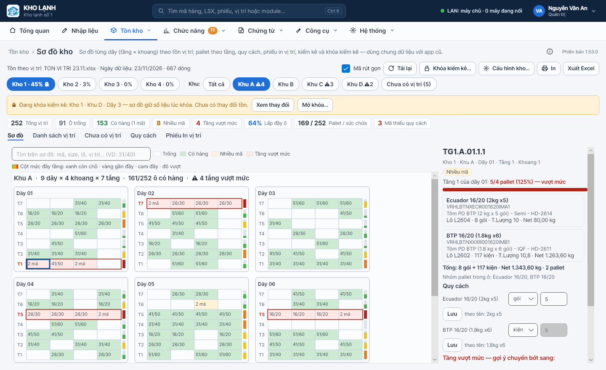
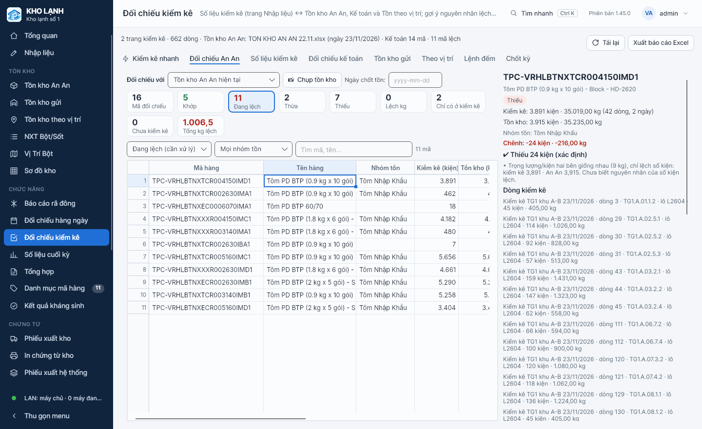
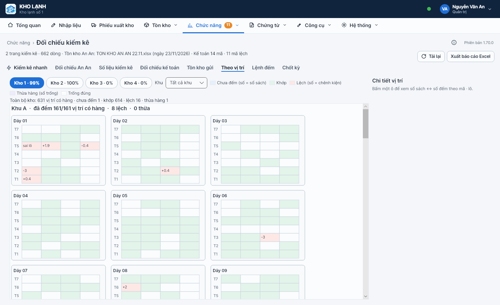
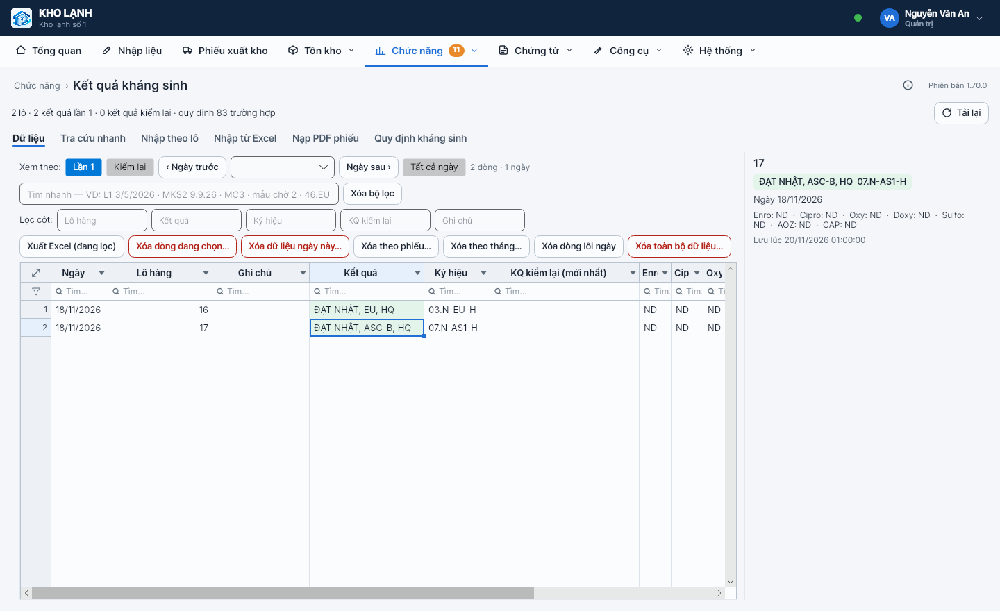
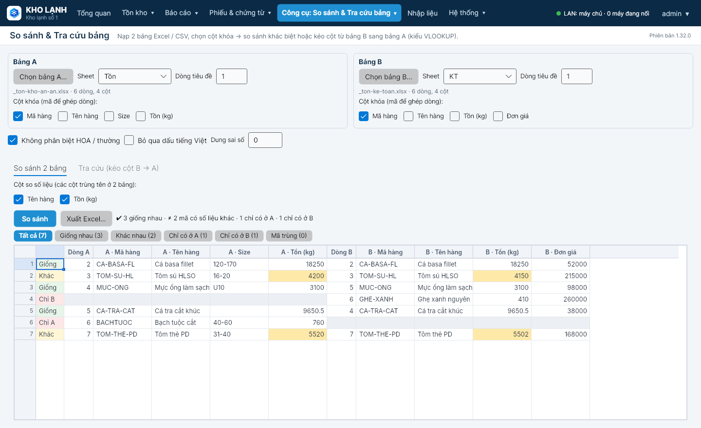
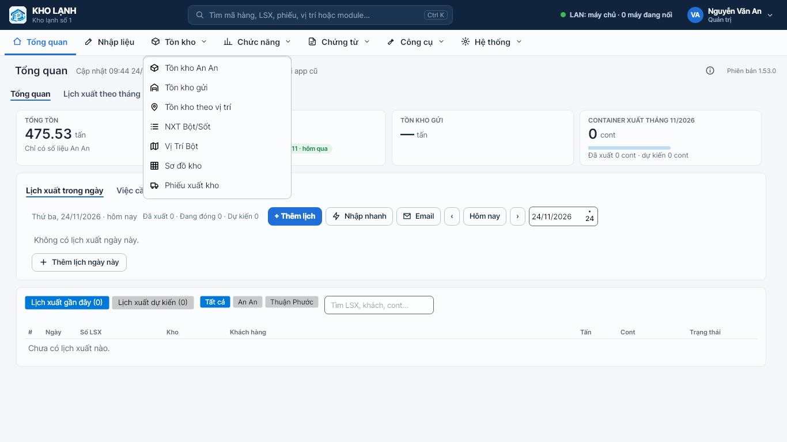
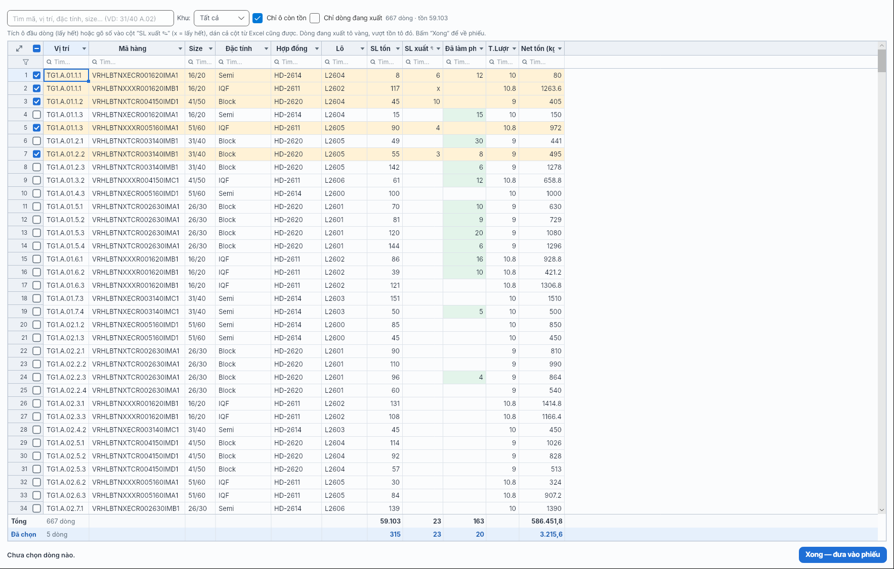
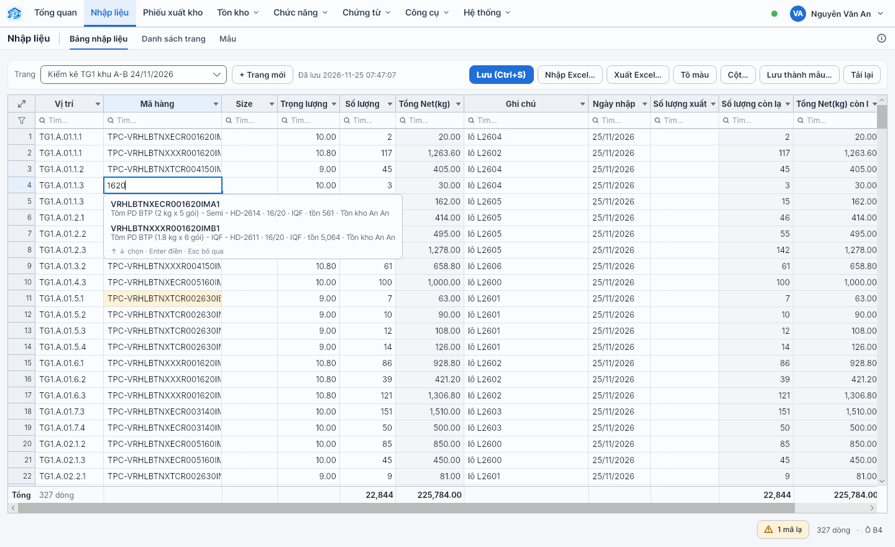
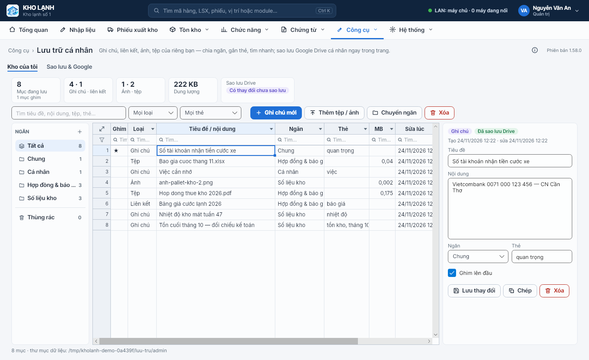
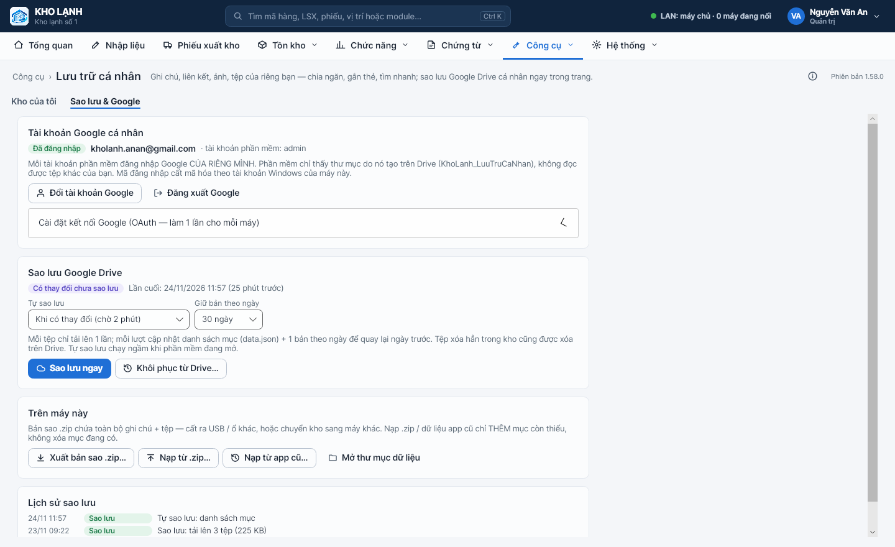

# Kho Lạnh C#

Phần mềm quản lý kho lạnh chạy trên Windows, viết bằng C# (.NET 8, giao diện Avalonia), dữ liệu SQLite cục bộ.
Đây là phần mềm **mới, tách riêng**: không dùng chung dữ liệu và không ảnh hưởng tới phần mềm kho cũ.


## Đồng bộ qua Google Drive

Máy ở mạng khác (không nối LAN) tải dữ liệu từ máy chính qua thư mục Google Drive, có thể gửi thay đổi ngược lên (ban ngày LAN ở công ty, ban đêm máy ở nhà làm độc lập; sao lưu tự động lên Drive mỗi ngày, khôi phục máy ở nhà, khóa gửi lên theo tài khoản) — xem [docs/DONG-BO-GOOGLE-DRIVE.md](docs/DONG-BO-GOOGLE-DRIVE.md).

## Máy chủ trên Google Cloud

Máy chủ LAN chạy không giao diện (`src/KhoLanh.Server`, Linux), kênh mã hóa AES-GCM — xem [docs/MAY-CHU-GOOGLE-CLOUD.md](docs/MAY-CHU-GOOGLE-CLOUD.md), file triển khai trong `deploy/`.

## Module hiện có

App đang được dựng lại theo từng module (từ bản 1.7.0 đã gỡ các module phiếu / tồn / sổ kho / báo cáo / danh mục của bản 1.0).

| Nhóm | Chức năng |
|---|---|
| Tổng quan · Lịch xuất | **Trang đầu tiên khi mở app** (theo Trang Chủ + Lịch xuất khẩu của app cũ, giao diện riêng C#), dùng chung database `lichxuat` với app cũ / điện thoại (LichXuatCont · TongKetThang · LX_ViecChuaLich · LX_TuDong). 4 thẻ: Tổng tồn · Tồn kho An An · Tồn kho gửi (kèm ngày dữ liệu, cũ ≥ 2 ngày báo vàng) · Container xuất tháng này (đã xuất / dự kiến; LSX chung cont tính 1). **Lịch xuất trong ngày** (lùi / tới / chọn ngày): mỗi container 1 thẻ — LSX, công ty An An / Thuận Phước, khách, giờ kéo đóng, việc cần làm, số cont, số xe (từ phiếu), tấn, trạng thái; nút **Tạo List** (từ tồn kho Thành Phẩm Chính theo cột Hợp đồng "26.11.020-17/11": ngày × size, MKS theo Đặc tính) / **Tạo phiếu xuất** (điền LSX, ngày, khách, số cont, áp List) — đã có thì thành nút mở thẳng List / phiếu; **✉ Cont** (dán email Thông tin xe → số cont); ✎ Sửa. **+ Thêm lịch** (tự dò Thành Phẩm Chính: khách, thị trường, hàng, size, tồn, tấn; chặn trùng LSX cùng ngày; chung container), **⚡ Nhập nhanh** (dán kế hoạch "Ngày 24/11: Xuất LSX 26.07.051 + 26.08.033; LSX 26.10.054" → xem trước → thêm), **✉ Email**: đọc Gmail bằng IMAP (mật khẩu ứng dụng, mã hóa trên máy, chỉ đọc), thư gốc có LSX trên tiêu đề = tạo lịch (ngày ETD), thư trả lời = đổi / hủy lịch (chỉ câu nói về kéo đóng / xuất hàng), thư «Thông tin xe» tự ghi số cont vào lịch và thông tin xe vào phiếu; thư của **người gửi tin cậy** qua lưới an toàn thì tự áp, còn lại chờ duyệt (sửa ngày / giờ, duyệt, bỏ qua, hoàn tác), tab Thử đọc thư, tự quét theo chu kỳ. Lịch xuất gần đây / dự kiến (lọc An An / Thuận Phước, tìm), **Việc cần làm** (việc đến hạn / quá hạn của từng LSX, chuẩn bị còn thiếu List · Phiếu · Cont cho hôm nay / ngày mai, việc cho LSX chưa có lịch — tự chuyển vào lịch khi có), **Thao tác nhanh** chọn theo tài khoản. Chi tiết lịch: chuẩn bị, hàng theo tồn kho, việc cần xử lý (tick, hạn mặc định trước ngày xuất 1 ngày, gợi ý việc hay dùng), chuyển ngày, đổi trạng thái, dò lại tồn. Tab **Lịch xuất theo tháng** và **Thống kê** (cont / tấn theo tháng, An An / Thuận Phước, khách nhiều nhất). Lịch ngày đã qua tự "Đã xuất". Quyền: "Tổng quan · Lịch xuất" (Xem / Sửa); mục **✉ Email** (kết nối Gmail, người gửi tin cậy, duyệt thư) chỉ tài khoản **Quản trị** thấy — máy đã khai báo Gmail vẫn tự quét nền khi tài khoản khác đăng nhập. |
| Tồn kho An An | **Viết bằng C# (không WebView2)**, dùng chung database `ton-kho-an-an` với app cũ: 6 tab (Load Data, Báo Cáo — từ 1.69 gồm Báo Cáo Tổng Tồn (luôn có dòng Bột + Sốt + Bếp, Kho Gửi, Tổng An An + Kho Gửi; nhắc khi xuất Excel thiếu số) và Đối Soát chung 1 tab, có khung cảnh báo khi lệch; Phân Loại 8 nhóm, Theo Dõi Tồn, Đặc Tính — đặc tính đã gộp hiện mờ / khóa, Tổng Hợp). Nạp file xlsx / xls / csv có bước xem trước và kiểm tra, lịch sử nạp + hoàn tác, so sánh 2 lần nạp; phiếu Xuất Hàng (ghi nhận rồi mới trừ tồn), Kho Gửi lấy từ Tồn kho gửi, 15 loại file Excel xuất ra. Bản WebView2 cũ vẫn còn ở mục “Tồn kho An An (bản cũ)” để đối chiếu. |
| Tồn kho gửi | **Viết bằng C# (không WebView2)**, dùng chung database `ton-kho-gui` với app cũ: 6 tab (Load Data — nạp file + bảng dữ liệu đang lưu ngay trong tab như Tồn kho An An, khung chi tiết dòng (1.64), Báo Cáo (tab 2 từ 1.69), Phiếu Xuất, Phân Loại 6 nhóm + Điều kiện lọc, Đặc Tính (đã gộp hiện mờ / khóa), Đối Soát có khung cảnh báo khi lệch). Nạp file xlsx / xls / csv có xem trước + kiểm tra, lịch sử nạp + hoàn tác; phân loại theo Số lô / Size (Ecuador, Ấn Độ, Gia Công, Giám Sát, Nguyên Liệu, HLSO) kèm điều kiện lọc tự thêm; Đặc Tính suy từ Tên hàng + bảng nhập tay + chuyển Số lô CKQ + gộp nhóm; phiếu xuất (tạo / sửa / xóa, trừ và hoàn Số kiện + Trọng lượng, phiếu đợt cũ bị khóa; lưới chọn hàng có cột Tổng kg (= tổng kg của dòng) và Tổng kg xuất, dòng Tổng / Đã chọn cộng cả hai — 1.173) xuất Excel “Phiếu yêu cầu xuất hàng” (logo Long An Logistics); xuất Excel Dữ Liệu / từng nhóm / Bảng Tổng Hợp. Bản WebView2 cũ còn ở mục “Tồn kho gửi (bản cũ)” để đối chiếu. Bảng Tổng Hợp Tùy Chọn ở tab Báo Cáo (chọn Size / Đặc Tính, ẩn cột trống, lưu mẫu, xuất Excel). Chưa so với dữ liệu thật. |
| NXT Bột/Sốt | Viết bằng C#, theo "Sổ kho bột / sốt" của app cũ, dùng chung database `nxt-bot-sot` (sổ cái `SoCai`, `SoKhoDinhMuc`, `SoKhoSanLuong`, `SoKhoCauHinh`, `_SoKhoLichSu`). Mọi nghiệp vụ là dòng sổ cái (tồn đầu · nhập · xuất · chuyển · điều chỉnh); tồn theo lô (vị trí · mã · size · hạn dùng · ngày nhập), xuất không chỉ định lô thì trừ **FIFO**, mốc tồn đầu. 8 tab: Phiếu nhập · Phiếu xuất · Chuyển vị trí (soạn trên lưới, kiểm tra, cảnh báo tràn lô / vượt định mức, in A4) · Tồn kho (theo mã + size / vị trí / lô / NXT kỳ / sắp hết hạn / tồn âm, chốt tồn đầu kỳ, xuất Excel) · Kiểm kê (số đếm → chênh → ghi điều chỉnh) · Định mức (định mức + sản lượng LSX → báo cáo vượt / thiếu, LSX chưa có định mức) · Sổ cái & lịch sử (lọc, xóa, nạp / xuất Excel, hoàn tác từng thao tác) · Cấu hình (dung sai, báo hạn, tồn tối thiểu). Lõi đối chiếu khớp tuyệt đối với lõi JS app cũ. Quyền "NXT Bột/Sốt". **Mẫu cột** (sheet `SoKhoMau`, dùng chung app cũ): Cấu hình › Mẫu cột phiếu — đổi tên / ẩn / sắp xếp cột, thêm cột phụ cho từng loại phiếu (mẫu chung · nhập · xuất · chuyển); cột phụ hiện ở Sổ cái. Tồn theo vị trí đưa lên Vị Trí Bột bằng nút "📱 Đưa lên Vị Trí Bột…". **1.172:** sửa lỗi “Cannot change source while update is in progress” khi chọn phiếu ở Phiếu nhập (sự kiện chọn nổi lên tab cha → dựng lại danh sách giữa lúc đang chọn); cùng kiểu handler được chặn ở An An, Kho gửi, Kiểm kê, Tồn vị trí, Tổng quan. |
| Vị Trí Bột | Viết bằng C#, theo "Vị Trí Bột" (M01VTB) của app cũ, dùng chung database `ton-kho-an-an` (sheet `ViTriBotMeta`, `ViTriBot`, `ViTriBotPhieuDienThoai`). Tồn bột / sốt theo vị trí được **đưa lên từ NXT Bột/Sốt › Tồn kho › "📱 Đưa lên Vị Trí Bột…"** (tồn cuối theo vị trí đến ngày chọn, thay toàn bộ dữ liệu cũ; phiếu đợt cũ bị khóa). Bảng tồn bỏ dòng SL = 0, tìm không dấu; gõ SL xuất ngay trên lưới ("x" = lấy hết) → "Tạo phiếu xuất" lưu và trừ ngay cột SL; danh sách phiếu PC / điện thoại: hủy trừ / trừ lại / xóa (hoàn SL). Quyền "Vị Trí Bột". **Điện thoại**: nút "📱 Đồng bộ điện thoại" dùng đúng Web App (Apps Script) của app điện thoại hiện có — nhận phiếu xuất Vị Trí Bột do điện thoại tạo (trừ tồn đúng dòng theo khóa, đánh dấu "Đã xử lý"; phiếu module khác giữ nguyên), rồi đẩy tồn lên tab `TonKho_M01_ViTriBot` + Meta; "Đưa lên Vị Trí Bột" từ NXT Bột/Sốt tự đẩy lên điện thoại khi đã kết nối ("Kết nối điện thoại…": đường dẫn Web App + mã PC_TOKEN, lưu trên máy). **1.177 — 2 ngăn:** ngăn **NXT** (đưa từ sổ kho, nhập trực tiếp) và ngăn **Excel** (nút "📄 Nạp Excel…" ở Vị Trí Bột và "📄 Nạp Excel Vị Trí Bột…" ở NXT Bột/Sốt › Tồn kho; nạp lại = THAY ngăn Excel, không cộng dồn; "Đưa lên Vị Trí Bột" chỉ thay ngăn NXT). File lệch mẫu vẫn nhận: dò cột VỊ TRÍ · MÃ BỘT · SỐ LƯỢNG (không nhận ra thì chọn cột tay), cột khác bỏ qua; dòng SL = 0 / thiếu vị trí bị bỏ. Cột **Nguồn** (Excel / NXT), 2 công tắc "điện thoại thấy ngăn NXT / ngăn Excel", **Đối chiếu 2 ngăn** (cùng mã + vị trí có ở cả hai). **Nạp file "Vị trí Bột" kiểu cũ** (dòng "NGÀY:" + tiêu đề VT · MÃ HÀNG · SL · NSX · HSD · NHẬP · NGÀY XUẤT · VỊ TRÍ CŨ · VỊ TRÍ MỚI · GHI CHÚ; có "Tải file mẫu"). |
| Tồn kho theo vị trí | Viết bằng C# (không WebView2), theo “Tồn Vị Trí An An” của app cũ, dùng chung dữ liệu (db `ton-vi-tri-an-an`). Nạp file Tồn kho theo vị trí (tự tìm dòng tiêu đề), tìm nhanh + lọc theo khu. Gõ / dán SL xuất ngay trên lưới (“x” = lấy hết ô), khung “Phiếu đang soạn” bên phải: loại phiếu (thay thùng / xuất xả), ngày, tiêu đề, gộp theo Size, cảnh báo (còn hàng ở vị trí khác, SL bất thường, trùng phiếu cùng ngày). Lưu phiếu trừ tồn ngay; sửa, hủy trừ / trừ lại, gộp / tách phiếu, tách mã ra phiếu mới, đổi loại / ngày, xóa (hoàn tồn), mở khóa phiếu đợt nạp cũ. Nạp file mới: đối chiếu phiếu đã trừ với file mới (khớp / chưa giảm / lệch), trừ lại phiếu hôm nay, liệt kê hàng đổi vị trí. Lưu trữ theo ngày (gộp theo ngày + loại), thống kê Size, xuất Excel theo mẫu cũ và ảnh PNG. In trực tiếp (nút 🖨 In: mở trang in A4 trong trình duyệt, In hoặc Lưu PDF) cho phiếu đang soạn / đã lưu / lưu trữ theo ngày. Chưa làm: nhận phiếu từ điện thoại. **1.165:** tab Phiếu xuất › ⋯ Thêm › **Trừ nhanh tồn An An…**: chọn phiếu vị trí → xem trước (ghép theo mã · đặc tính · hợp đồng; dòng không ghép / vượt tồn tô đỏ, không trừ) → tạo phiếu xuất An An và trừ ngay để xuất báo cáo An An nhanh; An An không có lô / vị trí nên chỉ trừ tổng; hủy bằng “Hủy trừ” ở An An; phiếu đã trừ được đánh dấu để hỏi lại khi trừ trùng. **1.164:** Tra cứu đã xuất — bảng hiện 20.000 dòng đầu + nút **Hiện tất cả**; dòng thông tin luôn ghi Tổng SL xuất / Net của TOÀN BỘ kết quả khớp. **1.163:** Tra cứu đã xuất chạy mượt với file Excel kho gốc cả năm (~33.000 dòng): danh sách dựng sẵn ở nền, gõ tìm chờ dừng tay và chỉ lọc (13 ms), bảng nạp dòng đầu + “Hiện tất cả”. **1.160:** tab **Tra cứu đã xuất** nạp được file Excel “Kho - Nhập xuất chi tiết” của phần mềm kho gốc — lưu RIÊNG với phiếu do app tạo (lọc *Mọi nguồn / Phiếu app tạo / Excel kho gốc*), nạp nhiều lần cộng dồn không nhân đôi, cột **Đối chiếu** (Khớp / Chưa thấy ở Excel / Chỉ có ở Excel), thêm Đặc tính + Hợp đồng, không đổi tồn theo vị trí. **1.54:** tab **Lập phiếu xuất** chỉ còn 1 bảng — phiếu đang soạn (đầu phiếu + các ô đã chọn, sửa SL xuất ngay trên bảng, xóa = bỏ dòng); nút **Chọn hàng từ tồn…** mở cửa sổ lớn chứa bảng tồn (lọc, tích ô đầu dòng / gõ SL) rồi "Xong — đưa vào phiếu". **1.63:** ô tìm theo đúng quy tắc app cũ — gõ nhãn size (“BTP 50 MKS”) chỉ ra đúng size đó, không lẫn 41/50, 35; gõ 1 con số (“50”) → ô đúng bằng số đó ([ảnh](docs/anh/24b1-vi-tri-tim-dung-size.png)); ô **Lọc vị trí đang chọn** hiện mọi mã còn tồn ở các vị trí đã có dòng đang xuất, kể cả mã chưa chọn ([ảnh](docs/anh/24b2-vi-tri-loc-vi-tri-dang-chon.png)). |
| Sơ đồ kho | Viết bằng C# (không WebView2), theo “Sơ đồ kho” của app cũ, dùng chung dữ liệu (db `so-do-vi-tri`; tồn đọc từ Tồn kho theo vị trí, vị trí dạng `TG1.A.01.1.1` = Kho.Khu.Dãy.Tầng.Khoang). Sơ đồ trực quan từng dãy (tầng × khoang, tầng cao ở trên), tô màu trống / có hàng / nhiều mã / tầng vượt mức, cột mức đầy pallet từng tầng, tìm và tô sáng ô trên sơ đồ; bấm ô xem hàng, pallet tầng, gợi ý chuyển khi tầng vượt mức. Danh sách vị trí có lọc (trạng thái, dãy, tầng, khoang), hàng chưa có vị trí (khu Z), quy cách kiện / gói (sửa trên lưới, điền theo tên hàng loạt), mã rút gọn / mã 21 ký tự. Phiếu In vị trí (**1.63:** 2 tab — **Vị trí có hàng** theo sổ sách, không in ô trống; **Vị trí trống (ghi tay)** in các ô không có hàng theo sơ đồ, hoặc phiếu trắng mọi vị trí — [ảnh](docs/anh/25g-so-do-phieu-in-vi-tri-trong.png); sửa trên bảng, gộp size, chuyển đề xuất, hoàn tác, xuất Excel A4), chuyển sang Nhập liệu (mẫu Kiểm kê) và rà soát chênh lệch, khóa kiểm kê theo kho / khu / dãy kèm xem thay đổi, cấu hình kho (dãy, khoang, tầng, dãy khác tầng), xuất Excel. In trực tiếp (🖨 In) danh sách vị trí và Phiếu In vị trí (mỗi dãy 1 trang A4, In hoặc Lưu PDF). |
| Đối chiếu kiểm kê | Viết bằng C# (không WebView2), theo “Số liệu kiểm kê” của app cũ (db `so-lieu-kiem-ke`). Số kiểm kê lấy từ các trang Nhập liệu mẫu Kiểm kê (chọn trang của kỳ, tự bỏ lần đếm cũ khi một vị trí đếm 2 ngày, xem chi tiết hoặc gộp theo mã). Đối chiếu với Tồn kho An An (hiện tại hoặc bản chụp tồn) theo mã, theo kiện và kg: Khớp / Thừa / Thiếu / Lệch kg / Chỉ có ở kiểm kê / Chưa kiểm kê, lọc nhanh, chi tiết từng dòng, gợi ý nguyên nhân (gõ sai mã, lệch trọng lượng, đếm trùng, lệch kiện) và sửa mã sai thẳng vào trang Nhập liệu. Đối chiếu Kế toán: dán từ Excel hoặc nạp file (Mã hàng, Tên, Trọng lượng, Số lượng, Net) rồi so theo kg. Theo vị trí: tô màu trên Sơ đồ kho (chưa đếm / khớp / lệch / thừa hàng) so với Tồn kho theo vị trí theo mã + lô, tiến độ từng kho / khu / dãy. Lệnh đếm theo dãy chia đều cho người đếm, xuất phiếu đếm Excel. Chốt kỳ kèm lý do (lưu bản chốt có số phiên bản, khóa thay đổi tới khi hủy chốt), xuất báo cáo Excel. Phân loại nhóm tồn theo module Tồn kho An An (Thành Phẩm Chính / Tạm / BM / HLSO / Gia Công / Nhập Khẩu / Nguyên Liệu / Giám Sát — đọc cả chuyển thủ công và điều kiện tự thêm), cột + lọc theo nhóm, ghi chú mã nằm nhiều nhóm; so theo LSX cho Thành Phẩm Chính (Khớp / Lệch / Thiếu thông tin, lọc “Lệch theo LSX”). Phát sinh nhập / xuất ghi ngay trên trang Nhập liệu (cột Ngày xuất / SL xuất / Ngày nhập / SL nhập) được quy số đếm về **Ngày chốt tồn** (cùng hoặc sau ngày đếm → trừ / cộng; trống ngày, trước ngày đếm, xuất quá số có → báo cần rà; sau ngày chốt → chỉ ghi nhận), hiện trong chi tiết từng mã. Tab **Tồn kho gửi**: lấy từ module Tồn kho gửi, đổi mã kho gửi 18–19 ký tự sang mã 21 (bảng chuyển đổi dùng chung với app cũ, không có thì tự đổi theo Mã hóa sản phẩm), cộng vào đối chiếu Kế toán (Tổng = kiểm kê + kho gửi); mã chỉ có ở kho gửi không lẫn vào đối chiếu An An. File Excel báo cáo có cột phát sinh nhập / xuất và sheet “Kho gui”, “Phat sinh”. Tab đầu **⚡ Kiểm kê nhanh** (theo app cũ PC 3.32): chọn / thả 1 hoặc nhiều file — app tự nhận Tồn kho An An / Kế toán / Tồn kho gửi theo tiêu đề cột (không rõ thì hỏi) và nạp bằng đúng chức năng của module đó (Tồn An An / Tồn gửi có xem trước, cảnh báo, hoàn tác); nguồn đang có, thẻ số (đã khớp · lệch SL / kg · chỉ có ở kiểm kê · chưa kiểm kê · % khớp), **Việc cần làm** tự lập (mỗi việc 1 nút: sửa mã gõ sai đủ chắc, xem từng nhóm lệch, mở Danh mục mã hàng…), **Sẵn sàng chốt?** + Chốt kỳ, báo cáo chênh lệch / file tổng; bảng kiểm kê ↔ tồn ↔ chênh (↔ kế toán) lọc nhanh, tìm, sao chép, xuất Excel, sửa mã dòng chọn, đúp chuột mở chi tiết ở tab Đối chiếu An An. |
| Số liệu cuối kỳ | Viết bằng C#, theo "Đối chiếu kế toán - kho" (M07) của app cũ, dùng chung database `so-lieu-cuoi-ky` (sheet DC2_*). Đối chiếu **tồn cuối kỳ theo mã (kg)**: Tồn kho = Tồn An An + Tồn kho gửi; Chênh lệch = Tồn kho − Kế toán. Nạp file Excel An An / Kế toán (sheet NXT + sheet chứng từ + danh mục thành phẩm) / Kho gửi (tiêu đề 2 tầng, mã 18–19 ký tự tự đổi sang 21) — tự nhận cột (nhớ theo tên cột), không chắc thì cho ánh xạ cột tay; kỳ đọc từ nội dung báo cáo. Mỗi mã lệch: nguyên nhân gắn nhãn **xác định / nghi ngờ** + độ tin cậy (chỉ có 1 bên, ngoài danh mục, nhầm mã / quy cách / chia mã, lệch đầu kỳ / phát sinh, chứng từ lệch NXT / bằng đúng chênh / trùng / ngoài kỳ, tự không khớp, sai Net, nhầm đơn vị, tồn âm…; không đủ bằng chứng → "Chưa xác định"), gợi ý mã nhầm (độ giống mã, 10 đoạn mã, tên, đối ứng số lượng), mã nghi ngờ xếp cạnh nhau, chứng từ có dấu hiệu. Xử lý: xác nhận nguyên nhân, sửa mã (chuyển kg ở kho hoặc kế toán), điều chỉnh, ghi chú, đánh dấu chứng từ, nạp file điều chỉnh, lịch sử + hoàn tác; nhiều máy cùng làm tự gộp. Xuất Excel 10 sheet. Lõi khớp tuyệt đối với lõi JS app cũ (test đối chiếu). Quyền "Số liệu cuối kỳ". Nguồn An An / Tồn kho gửi **lấy thẳng từ module** (file đang nạp trong module, đi qua đúng bộ đọc file) hoặc nạp file; nguồn tuỳ chọn **Chứng từ nhập / xuất An An** (báo cáo nhập / xuất trong kỳ → phân tích chứng từ kho ↔ kế toán, đối chiếu khớp lõi JS); tab **Dữ liệu nguồn**: sửa ô Mã hàng / Số lượng kg của từng dòng (chỉ ghi phần sửa, file nạp giữ nguyên, ô đã sửa tô vàng, trả lại giá trị gốc, hoàn tác ở Lịch sử). |
| Tổng hợp | Viết bằng C# (không WebView2), dùng chung dữ liệu với app cũ (db `tong-hop`). Mã hóa sản phẩm 21 ký tự (10 tổ hợp, danh sách chuẩn), danh sách mã hàng (11.603 mã mặc định, tô đỏ mã sai độ dài, tô vàng mã trùng / tổ hợp chưa khai báo, ghép mã), Bảng 1 nhập từ Excel → Bảng 2 gộp theo Ngày + Tên sản phẩm + Size, ánh xạ tên hàng (quy tắc đơn, kết hợp). Tra cứu kháng sinh nay là module riêng “Kết quả kháng sinh”. |
| Danh mục mã hàng | Viết bằng C#, theo "Danh mục mã hàng" của app cũ (PC 1.70). Gốc = Danh sách mã hàng của Tổng hợp (db `tong-hop`, sheet `MaDaTao`, ghi kèm `M8_Meta`) — sửa ở đây là sửa đúng danh sách đó, Tổng hợp đang mở cập nhật theo. Lưới kiểu Excel (gõ / dán thẳng, thêm mã ở dòng trống cuối bảng — diễn giải để trống thì tự dựng từ Mã hóa sản phẩm, tự lưu), tìm không dấu, lọc Trùng mã / Nghi gõ sai / Đoạn chưa khai báo, hiện tối đa 2.000 dòng. Cột Size (đoạn 8), Trọng lượng (đoạn 9), **Đang dùng ở** (số dòng có mã trong Tồn kho An An · Tồn theo vị trí · Vị Trí Bột · Tồn kho gửi · NXT Bột/Sốt) và Kiểm tra (thiếu / không đủ 21 ký tự / trùng; đoạn chưa khai báo; nghi gõ sai = khác đúng 1 ký tự mà ký tự đó làm đoạn chưa khai báo), tô đỏ / vàng. Tab **Cần xử lý**: mã đang dùng chưa có trong danh mục (thêm tất cả / thêm dòng chọn), mã trùng, cặp nghi gõ sai (mở trên lưới), số mã có đoạn chưa khai báo. Xóa dòng đã chọn, xuất Excel 7 cột. Đổi mã ở đây không sửa mã trong tồn kho / phiếu cũ. |
| Kết quả kháng sinh | Viết bằng C# (không WebView2), theo “Tra cứu kháng sinh” của app cũ, db riêng `ket-qua-khang-sinh` (nút “Chép dữ liệu từ app cũ” lấy từ `tong-hop/KhangSinh`). Dữ liệu theo ngày, chế độ Lần 1 / Kiểm lại, ô tìm nhanh (lô, ngày, MKS / mẫu chờ), lọc theo cột, xóa theo dòng / ngày / phiếu / tháng, xuất Excel. Tra cứu nhanh 7 chỉ tiêu (chọn trường hợp khớp y như app cũ), nhập theo lô trên lưới (tự tính Kết quả + Ký hiệu), nhập từ Excel (mỗi sheet một ngày, tự đoán cột), Quy định kháng sinh 83 trường hợp sửa trên lưới. Nạp PDF phiếu kết quả lần 1 (Kho) và kiểm lại (MKS chờ) như app cũ: đọc mỗi phiếu bằng 2 cách độc lập (theo cột / theo thứ tự chữ) rồi đối soát Lô · Mẫu · Đặt tính, sửa tay trên lưới, ảnh trang PDF gốc bên cạnh có khung đúng hàng mẫu, mục lệch phải tick "Đã so" mới nhập; lần 1 cập nhật lô (Ngày nhập + Số lô), kiểm lại gắn vào lô theo "Lô: N (ngày)"; PDF dạng bảng khác chuyển sang khớp cột như Excel. Đọc PDF bằng PdfPig, vẽ trang bằng PDFium, cả hai gói sẵn trong exe. **1.162:** tìm mẫu chờ lần 2 nhận nhiều cách viết, có hoặc không khoảng trắng: `MKS2`, `MKSC2`, `MCKSS2`, `MCS2`, `MC2`, `MAU2`, `M2`, “mẫu kháng sinh chờ 2”… (`M` / `MAU` chỉ tính là mẫu khi kèm số — lần 1 tên lô là L2). Áp cả app điện thoại (2.4).  **1.175: tab “Tôm nhập khẩu”** — kết quả kháng sinh của cả cont hàng nhập (không có lô; định danh INV · Contract · **TP** (số trong Contract) · Size · số mẫu): nạp PDF phiếu ở tab “Nạp PDF phiếu” (tự nhận ra, nhiều file / nhiều Size một phiếu), phiếu “Cập nhật” cùng INV + Contract + Size thay bản cũ (bản cũ giữ trong lịch sử), gõ `TP143 size 31/35` hay `INV MNSF-155` ra thẻ kết quả (số mẫu đạt / nhiễm, chỉ tiêu nhiễm, đặc tính) ([ảnh](docs/anh/51-tom-nhap-khau-tp143.png)); phiếu xuất nội địa gõ cùng cách ở cột Lô (cont có mẫu nhiễm thì không tự điền, chọn số kết quả tay); đẩy sang điện thoại bản gọn (xem [docs/DONG-BO-DIEN-THOAI.md](docs/DONG-BO-DIEN-THOAI.md)). |
| Báo cáo rã đông | Viết bằng C# (không WebView2), dùng chung dữ liệu với app cũ (db `bao-cao-ra-dong`). Nạp file báo cáo kho (tự tìm dòng tiêu đề, bỏ tiền tố TPC-), tab **Số liệu nạp (gộp theo ngày)** gộp theo Ngày + Tên sản phẩm + Size (Net thiếu tự tính, sửa tay, bảng chưa gộp, hoàn tác), tab **Số liệu đã lưu theo ngày** (thay thế / cập nhật giữ dòng sửa tay / cộng dồn, hoàn tác cập nhật), Excel năm theo mẫu, ảnh bảng ngày. **1.64:** tích ô vuông đầu dòng các ngày → **Gộp ảnh N ngày đã tích** (như app cũ, ngày cũ ở trên) ([ảnh](docs/anh/22c-ra-dong-tich-ngay.png), [ảnh gộp](docs/anh/22d-ra-dong-anh-gop.png)); sửa ảnh xem trước bị cắt mất 3/4 trên Windows. (Trước 1.64 hai tab tên “Bảng 2”, “Bảng 3”.) Nút “Lấy từ Đối chiếu hàng ngày” (cập nhật Bảng 3 từ file Xuất rã đông đã liên kết) và “Kiểm ngày thiếu”. |
| Đối chiếu hàng ngày | Viết bằng C# (không WebView2), theo M16 của app cũ. Liên kết 3 file Excel trên máy (lưu theo tài khoản): Xuất thay thùng, Xuất rã đông (app ghi thẳng) và Xưởng (chỉ đọc, 2 sheet tự ghép theo số mã trùng). So theo Ngày + Mã (khớp / lệch / chỉ có ở Kho / chỉ có ở Xưởng / ghi 0), BTP / NL so nhanh theo Size + kg/thùng, gợi ý mã nằm nhầm file, nghi sai mã. Sửa SL Kho ngay trên lưới, chuyển mã giữa 2 file, thêm dòng, sửa mã / ngày, xóa, nạp file gốc của phần mềm kho (thêm ngày mới / thay ngày khác số); ghi file giữ nguyên mẫu (sửa XML trực tiếp, dòng tổng ngày = SUM), ghi cả 2 file hoặc không file nào, sao lưu 1 bản / ngày (giữ 7 ngày), lịch sử + hoàn tác. Sửa tay số Xưởng chỉ để đối chiếu. Xuất Excel kết quả. Tab **Xuất kiểm**: chọn file gốc của phần mềm kho → tách riêng dòng "Xuất kiểm hàng", gộp theo Ngày + Mã hàng thành danh sách rút gọn 8 cột, "Cập nhật tên hàng" (tra theo mã từ Danh sách mã hàng rồi Mã hóa sản phẩm, xem trước, chọn từng dòng, hoàn tác), xuất file rút gọn. Thêm cột Size vào file Kho (🔠, theo từ điển Mã hóa sản phẩm, xem trước rồi ghi; không đè ô đã có). File gốc nạp được cả .csv; tên + trọng lượng khi thêm dòng được tra thêm từ Tồn kho An An. Chưa làm (so với app cũ): “Nạp tạm”, đọc file gốc .xls (cần thêm thư viện đọc Excel cũ). **1.166:** dòng tổng mỗi ngày nằm DƯỚI khối chi tiết (như file Excel), ghi “TỔNG”, không tô nền ô — số chữ xanh lá, lệch (Δ, “Có lệch”) chữ đỏ. **1.169:** tab Xuất kiểm nạp lại được FILE RÚT GỌN do chính tab xuất ra (8 cột, không có “Loại chứng từ”): coi mọi dòng có mã + ngày là Xuất kiểm hàng. **1.170:** tab Xuất kiểm có ô tích từng dòng + ô chọn tất cả; nút **⇥ Chuyển sang file xuất…** chuyển 1 hoặc nhiều mã sang file Xuất thay thùng / Xuất rã đông (ghi thêm dòng vào file Excel Kho, hoàn tác được); mã đã chuyển ghi chú “Xuất kiểm”, trạng thái Xuất kiểm và KHÔNG đối chiếu với Xưởng (không tính lệch / chỉ có ở Kho, không vào Δ ngày), cột “Đã chuyển” chặn chuyển trùng. **1.171:** chuyển Xuất kiểm sang file xuất thì chữ “Xuất kiểm” cũng được GHI VÀO FILE EXCEL Kho (cột Ghi chú; file chưa có cột này thì thêm 1 cột cuối, không dịch ô / công thức nào; đã có thì chỉ điền ô trống). |
| Phiếu xuất kho | Viết bằng C# (không WebView2), theo "Phiếu nhập/xuất kho" của app cũ, dùng chung dữ liệu (db `phieu-nhap-xuat`, sheet `PNX_Phieu`). **Từ 1.82: danh sách phiếu xuất khẩu / nội địa nhóm theo THÁNG** (dòng tháng ghi số phiếu + tổng kiện / kg, bấm để mở / thu, tháng mới nhất trên cùng, mặc định mở 2 tháng mới nhất, nhớ theo tài khoản; nút Mở hết / Thu hết / Chỉ tháng mới nhất; đang lọc theo cột thì mở mọi tháng) **và khung soạn phiếu chiếm cả trang** (bấm đúp / Enter mở phiếu: 1 thanh trên “← Danh sách · tên phiếu · trạng thái · Lưu · Xuất Excel · ⋯ Thêm · ✕ Đóng phiếu”, ESC = về danh sách, chưa lưu thì hỏi Lưu rồi đóng / Bỏ thay đổi / Ở lại; mặt hàng / mục hàng xếp dọc, mục đang sửa mở to hết phần còn lại, mục khác thu 1 dòng; thông tin phiếu – xe – cuối phiếu (xuất khẩu) / thông tin cont – tổng – cần xử lý (nội địa) ở khung phải thu / mở được) ([danh sách](docs/anh/30-phieu-xuat-khau-danh-sach.png), [nhập liệu](docs/anh/30b-phieu-xuat-khau-nhap-lieu.png), [nội địa](docs/anh/31b-phieu-noi-dia-nhap-lieu.png)). Nội địa còn tab Danh mục. **Phiếu xuất khẩu theo LSX** (nạp List sản xuất PDF / Excel, thống kê xuất khẩu theo tháng), tab **List sản xuất** (kho List theo LSX: tình trạng theo tồn Thành Phẩm Chính · số phiếu · lịch xuất — Chờ xuất / Hoàn tất / Hết tồn chưa có phiếu / Đã xuất mà tồn còn…; nạp nhiều file, ⟳ Quét tồn kho tự tạo List cho LSX còn tồn, xem ngày × size, gán Tên / Mã / Lô cho size, tạo phiếu từ List) **và Cargo list** cho Xuất Thuận Phước / Gia công / Gửi kho (mỗi cont = 1 Cargo + 1 phiếu: gõ Loại + Size-quy cách `0040-6` + Lô `22.05.26 L16` + số kiện từng dãy → tự ra mã hàng 25 ký tự và TRA kết quả kháng sinh theo ngày + lô, gom phiếu theo nhóm thị trường, đổ đầy từng dãy, dán thông tin xe, danh mục loại hàng / quy cách, xuất Excel theo mẫu thật). Soạn phiếu (mặt hàng × dòng DATE · size · kiện · MKS, NET theo quy cách `1.0 kg x 5 x 2` hoặc sửa tay), tự cấp số phiếu `NN.MM XKAA KK` theo tháng và hàng AA / TP, dán email "Thông tin xe" (tách 7 mục), nội dung email gửi kèm, xuất Excel `.xlsm` bằng cách điền thẳng vào file mẫu (giữ nguyên định dạng, hình, macro). Cargo list có dò tồn kho An An theo mã hàng (đủ tồn / vượt tồn / hết / không có mã + gợi ý mã gần giống, cảnh báo không chặn xuất). Tab Danh mục có “🪄 Gợi ý Mã gói + Tiền tố” cho quy cách mới (từ Mã hóa sản phẩm + Danh sách mã hàng). Các loại phiếu nhập / Xuất nội địa / chiếu xạ / khác: app cũ cũng chưa có mẫu Excel nên chưa làm. **⚡ Tự tạo theo Lịch xuất**: thêm lịch XUẤT (ngày ≥ hôm nay) hoặc đổi LSX / loại lịch — từ mọi đường (hộp Thêm, Thêm nhanh, Trợ lý, email) — tự có List sản xuất cho từng LSX (từ tồn kho; chưa có hàng → List trống theo tên LSX), tuỳ chọn tạo luôn Phiếu xuất kho; mở Lịch xuất tự rà bù lịch 14 ngày tới; mỗi LSX chỉ tự tạo 1 lần (nhật ký `PNX_AutoLog` dùng chung app cũ), xóa lịch không xóa List / Phiếu. Tab "⚡ Tự động đã tạo" (lọc, chỉ mục chưa xem, đánh dấu đã xem, mở mục) + nút ⚡ trên thanh menu. |
| In chứng từ kho | Viết bằng C#, theo "In chứng từ kho" của app cũ (db `in-chung-tu-kho`). Nạp Excel xuất kho (Xuất TBB / Xuất Xả / Xuất Kiểm, tự tìm dòng tiêu đề, nhận tiêu đề gần đúng), mỗi ngày chứng từ = 1 Phiếu xuất (DISPATCHING NOTE BM02/QT23), gộp nhiều ngày, tách dòng sang phiếu riêng cùng ngày, bổ sung tên hàng bị cắt từ mã 21 ký tự (Mã hóa sản phẩm), người ký, in / lưu PDF qua trình duyệt, xuất Excel theo mẫu. |
| Phiếu xuất hệ thống | Viết bằng C#, theo M09 của app cũ, chỉ đọc: gom phiếu xuất của Tồn kho An An, Tồn theo vị trí, Tồn kho gửi, NXT Bột/Sốt; lọc theo ngày / module / nguồn / người tạo, tìm cả mã hàng trong phiếu, xem chi tiết, xuất Excel. |
| Xử lý PDF & Excel | Viết bằng C#, theo "Xử lý PDF & Excel" (M21) của app cũ, chạy hoàn toàn trên máy (PDFium gói sẵn), **file gốc không bị ghi đè**. PDF: gộp nhiều file (đổi thứ tự), tách / lấy trang (khoảng trang, mỗi trang, mỗi N trang), xoay / xóa trang, đánh số trang + chữ chìm + hình con dấu / chữ ký (bỏ nền trắng), xóa trang trắng (3 mức nhạy), giảm dung lượng (vẽ lại thành ảnh nén 150 / 110 / 80 dpi), ảnh → PDF, PDF → ảnh JPG / PNG. Excel: gộp nhiều file / sheet (xếp chồng theo tên cột + cột Nguồn, hoặc mỗi bảng 1 sheet), tách theo giá trị cột / mỗi N dòng (1 file nhiều sheet hoặc nhiều file), làm sạch (khoảng trắng, dòng trống, dòng trùng, số / ngày dạng chữ; kèm sheet "Đã sửa" và "Ô cần xem lại"). Lõi bảng đối chiếu khớp lõi JS `cc-bang-engine.js`. Quyền "Xử lý PDF & Excel". Chọn file PDF là thấy **ảnh xem trước** các trang (60 trang đầu); làm sạch Excel có **tùy chọn riêng từng cột** (đổi số / ngày / chữ hoa / thường / hoa đầu từ, chọn cột so trùng); ô ngày trong Excel giữ là ngày. |
| So sánh & Tra cứu bảng | Viết bằng C#, theo "So sánh & Tra cứu bảng" (M22) của app cũ. Nạp 2 bảng Excel / CSV (chọn sheet, dòng tiêu đề tự đoán), chọn cột khóa (tự chọn cột trùng tên). **So sánh**: giống nhau / khác số liệu theo các cột trùng tên / chỉ có ở A / chỉ có ở B / mã trùng; xem 2 bảng song song căn theo khóa (ô khác tô vàng); tùy chọn không phân biệt hoa thường, bỏ dấu, dung sai số; xuất Excel 6 sheet. **Tra cứu** kiểu VLOOKUP: kéo các cột của B sang A, mã nhiều dòng ở B → lấy đầu / cuối / cộng / nối / đếm; xuất Excel kèm sheet "Không tìm thấy". Lõi khớp `cc-bang-engine.js`. Quyền "So sánh & Tra cứu bảng". Ô ngày hiện dd/mm/yyyy. |
| Lưu trữ cá nhân (1.60) | Công cụ › **Lưu trữ cá nhân** (quyền `m19`), làm lại M19 của app cũ theo kiểu mới: ghi chú / liên kết / ảnh / tệp **riêng từng tài khoản** trong 1 bảng (lọc cột, tìm không dấu, lọc loại / thẻ, ghim), **ngăn** bên trái, khung sửa bên phải, kéo thả tệp, thùng rác, thẻ số (số mục, dung lượng, trạng thái sao lưu). Tab **Sao lưu & Google**: **đăng nhập Gmail cá nhân ngay trong module** (OAuth trình duyệt, quyền `drive.file`), tự sao lưu Google Drive (khi có thay đổi / mỗi giờ / 6 giờ / mỗi ngày), giữ bản theo ngày, khôi phục (bản mới nhất hoặc theo ngày), xuất / nạp `.zip`, **nạp Lưu trữ cá nhân của app cũ** (đọc `config/luu-tru/<tài khoản>/data.json`, cùng định dạng). Hướng dẫn tạo OAuth client: [docs/LUU-TRU-CA-NHAN.md](docs/LUU-TRU-CA-NHAN.md). |
| Phiếu xuất khẩu 3 mặt hàng trên 1 trang (1.188) | Khung soạn phiếu xuất khẩu mở sẵn mọi mặt hàng xếp dọc như tờ Excel, cuộn dọc; «▾ Mặt hàng n» thu gọn từng cái; thanh tổng cả phiếu cố định ở đáy |
| Rã đông: thêm mã hàng nhập tay (1.187) | Báo cáo rã đông › Số liệu nạp › nút «＋ Thêm mã hàng»: gõ mã (gợi ý từ Tồn kho An An) + số lượng (+ ngày), app tự điền tên hàng, trọng lượng, Net và ánh xạ Tên sản phẩm / Size; dòng nhập tay tô hồng ở Dòng gốc, hoàn tác được |
| Trợ lý nâng cấp (1.186) | Kiểm tra lịch xuất / phiếu xuất khẩu (thiếu phiếu, thiếu số xe, trùng phiếu / cont), đồng bộ giữa các máy, email lịch xuất (lâu chưa quét, thư xe chưa điền vào phiếu), tự kiểm sau cập nhật (bảng mất dòng, toàn vẹn CSDL) · Sửa nhanh thêm: nối lại máy chủ, quét email, nạp lại cài đặt, tạo lại chỉ mục · nút 📊 Báo cáo tuần + nhắc mỗi 7 ngày |
| Bôi đen ổn định, bấm LSX (1.185) | Hết kẹt "rê tới đâu bôi đen tới đó" sau khi tắt hộp thoại; bôi tới cuối dòng được; bấm đúp liên tiếp vẫn kéo được; bấm LSX mở chi tiết ngay 1 lần (khi nhả chuột), kéo bôi đen chữ không mở |
| Lịch xuất: số xe + quét mail khi tạo phiếu, bôi đen kéo ngắn (1.184) | Tổng quan › Lịch xuất trong ngày: cột Xe lấy số xe từ thư «Thông tin xe» (kể cả chưa có phiếu), «việc cần làm» có cột riêng trước Cont · bấm Tạo phiếu xuất → quét lại email trước để phiếu mới có ngay thông tin xe · bôi đen chữ kéo ~nửa ký tự là được (ngưỡng kéo 4 → 1,5 px) |
| Kiểm soát khi nạp tôm nhập khẩu (1.183) | Hộp "Nạp phiếu tôm nhập khẩu": cột Tình trạng (xanh đọc đủ / vàng cần xem / đỏ thiếu thông tin — không nạp được), sửa ô định danh tại chỗ (ô đã sửa tô xanh dương, rê chuột xem giá trị đọc từ PDF), "Mở mẫu" sửa từng mẫu, "Xem file gốc", cột Mẫu đọc (58/60), ô Duyệt (chỉ nạp dòng đã duyệt), bộ lọc dòng cần xem, ⋯ Hoàn tác lần nạp vừa rồi |
| Nạp nhiều phiếu tôm nhập khẩu (1.182) | Hộp xác nhận nạp PDF tôm nhập khẩu thành bảng (mỗi Size 1 dòng, mẫu nhiễm tô vàng, cột Nạp = Mới / Thay phiếu cũ) + khung cảnh báo cuộn được — nạp nhiều file không còn khuất nút Nạp. Mẫu ghi "Ngày 02.02, 60 kiện, Mẫu 28 :" (không ghi tên hàng / Size) lấy theo Size duy nhất của phiếu, chữ gốc vào Ghi chú (trước tách thành Size rỗng riêng). Mọi hộp Thông báo / Xác nhận chữ dài tự cuộn. Ảnh: `docs/anh/v253-nap-nhieu-file-tom-nhap-khau.png`. |
| Nạp sẵn trang lúc rảnh (1.181) | Sau khi đăng nhập, lúc không thao tác (≥ 2 giây, không có hộp thoại), app dựng ngầm từng trang hay mở nhất của tài khoản (chưa có thì Nhập liệu · Phiếu xuất kho · Tồn kho An An · Tồn theo vị trí; tối đa 4) để lần mở đầu gần như tức thì (đo 8.000 dòng: Tồn kho An An 560 → 96 ms, Tồn theo vị trí 760 → 63 ms). Dữ liệu trang đã đọc đổi → mở là dựng lại; trang nạp ngầm bị lỗi không hiện hộp thoại, mở thật sẽ nạp lại. Tắt: settings `ui_napsan` = "0". |
| Thứ tự menu Chức năng (1.180) | Báo cáo rã đông · Đối chiếu hàng ngày · Đối chiếu kiểm kê · Số liệu cuối kỳ · In chứng từ kho · Kết quả kháng sinh · Chấm công · Tổng hợp · Danh mục mã hàng — Tài khoản › Phân quyền xếp cùng thứ tự. |
| Chấm công › Tăng ca buổi trưa (1.159) | Tab Chi tiết ngày có cột **TC trưa ✎** (ngay sau V.Sớm): gõ **x** = làm xuyên cả buổi trưa (không trừ nghỉ trưa của bộ phận), hoặc số giờ (0.5, 1) / số phút (30p) nếu chỉ nghỉ một phần. Giờ đó cộng vào công ngày ấy và được dùng sang công bù ngày thiếu như giờ làm thêm; tối đa bằng giờ nghỉ trưa của bộ phận, ngày nửa buổi (không trừ nghỉ trưa) thì không cộng. Bảng công có cột “TC trưa (giờ)” tổng tháng, rê chuột ô ngày thấy giờ tăng ca trưa; Excel thêm cột “Tăng ca trưa” (sheet Chi tiết) và “Tăng ca trưa (giờ)” (Bảng công). |
| Scan › tab Đã lưu gộp tài liệu đã lưu (1.158) | Bỏ nút “Tài liệu đã lưu”: tài liệu bấm 💾 Lưu (sửa tiếp được) hiện ngay đầu tab **Đã lưu**, cùng file PDF / JPG đã xuất. Chọn tài liệu → “Mở file” (hoặc bấm đúp) = mở lại ở tab Làm việc để sửa tiếp; Xóa = xóa hẳn tài liệu. |
| Xuất file đè file cũ không nhảy chỗ (1.157) | Xuất Excel ra Desktop (hoặc thư mục bất kỳ) trùng tên file cũ: app ghi đè thẳng vào file cũ thay vì xóa rồi tạo lại, nên biểu tượng trên Desktop giữ nguyên chỗ; file được dựng xong trong bộ nhớ rồi mới ghi, lỗi giữa chừng thì file cũ còn nguyên. |
| Giữ bản sao lưu Drive (1.156) | Ghi rõ quy tắc ở Sao lưu › Google Drive cá nhân: hôm nay giữ mọi bản (vd mỗi giờ 1 bản = 24 bản); sang ngày mới, mỗi ngày cũ chỉ giữ bản mới nhất của ngày đó (14 ngày gần nhất) + bản mới nhất mỗi tháng (12 tháng); bản thừa tự xóa ở lần sao lưu kế tiếp. |
| Lịch tự sao lưu Drive không bị mất (1.155) | Chu kỳ **Tự sao lưu** ở Đồng bộ & sao lưu › Sao lưu › Google Drive cá nhân (vd “Mỗi giờ”) nay có bản dự phòng ngoài bảng cài đặt như vai máy chủ (1.143): bảng cài đặt bị làm trống (phần mềm dọn rác…) thì mở app tự nạp lại, không còn về “Mỗi ngày”. Kèm: chu kỳ / chế độ tự đồng bộ điện thoại và ô tự lưu file Công cụ. |
| Công cụ › Đã lưu + tự lưu vào Lưu trữ cá nhân (1.154) | Scan tài liệu, Container 3D, Xử lý PDF & Excel, So sánh & Tra cứu bảng có tab **Đã lưu**: danh sách file đã xuất (mở, mở thư mục, xóa khỏi danh sách / xóa cả file). File luôn nằm ở nơi bạn chọn trong hộp “Lưu thành…” (Scan › 💾 Lưu cất tài liệu chỉnh sửa được riêng, ở nút “Tài liệu đã lưu”). Ô tích **Tự lưu file vào Lưu trữ cá nhân** (nhớ theo tài khoản): file xuất ra được chép vào ngăn “Công cụ” của Lưu trữ cá nhân và đẩy lên Google Drive nếu đã đăng nhập Google (dùng chung đăng nhập với Sao lưu Drive); chưa đăng nhập thì lưu trên máy và báo rõ. |
| Nhập liệu | Viết bằng C# (không WebView2). Các trang dạng lưới Excel: gõ / dán thẳng từ Excel (Ctrl+C / Ctrl+V), hoàn tác, điền xuống, tự lưu, mẫu cột (Kiểm kê, mẫu tự lưu; 1.174 bỏ mẫu Nhập kho / Xuất kho), nhập / xuất Excel, thùng rác. Lưới dùng chung: `src/KhoLanh.App/Controls/SheetGrid.cs` + `src/KhoLanh.Core/Grid/GridModel.cs`. **1.54:** bảng nhập rộng hết trang (đổi trang bằng ô **Trang** trên đầu bảng), danh sách trang / thùng rác ở tab **Danh sách trang**; cột **Mã hàng** có **gợi ý khi gõ** (mã đang có tồn ở mọi module + Danh mục mã hàng, tìm không dấu theo mã / tên / size; chọn bằng ↑ ↓ + Enter, tự điền Tên hàng / Size / Đặc tính nếu trống; mã lạ tô vàng nhạt). **1.62:** tab **Mẫu** — xem / sửa mẫu có sẵn (lưu bản sửa, “Về mặc định”), thêm / nhân bản / xóa mẫu tự tạo, tạo trang từ mẫu; mỗi cột có Kiểu, Độ rộng, **Tự điền** (Tên hàng / Size / Trọng lượng theo mã hàng, Ngày tạo dòng) và **Công thức** kiểu Excel (`=[Số lượng]*[Trọng lượng]`, `=E2*D2`, SUM, ROUND, IF, IFERROR, AND / OR, LEFT / RIGHT / MID, CONCAT, TODAY…; cột công thức tự tính, nền xám). Mẫu **Kiểm kê** mới: Vị trí, Mã hàng, Size, Trọng lượng, Số lượng, Net(kg) = Số lượng × Trọng lượng, Ghi chú, Ngày nhập (tự điền ngày khi dòng được nhập lần đầu, sửa tay được, sửa phiếu về sau không đổi ngày). Dán / gõ / điền xuống mã hàng (cả nhiều dòng) → các cột theo mã tự cập nhật, cả ở trang cũ (cột cùng tên, chỉ khi ô trống hoặc đang là giá trị tự điền). **Tô màu ô** (nút Tô màu / chuột phải: 7 màu + Bỏ màu; lưu theo dòng, xuất Excel giữ màu) ([ảnh](docs/anh/20-nhap-lieu.png), [tab Mẫu](docs/anh/20d-nhap-lieu-mau.png)). Toàn app: bỏ dòng mô tả cạnh tiêu đề module (mô tả chuyển vào nút ⓘ Hướng dẫn). |
| Tài khoản | Đăng nhập (nhớ mật khẩu, tự đăng nhập; **Khởi động cùng Windows** — mọi tài khoản tự bật ở menu tài khoản hoặc Sao lưu và cài đặt: bật máy là phần mềm tự mở và vào thẳng, hợp cho máy chủ), 3 vai trò + phân quyền tới từng module. Dùng chung cho mọi máy qua Google Sheet: `docs/TAI-KHOAN-DUNG-CHUNG.md`. **1.56:** trang Tài khoản 2 tab — Danh sách (bảng rộng, có cột Vai máy LAN) · Thông tin & phân quyền (bảng quyền rộng hết trang, 3 cột theo nhóm, ô **Vai máy LAN** gán vai máy chủ / dự phòng / máy con cho tài khoản). |
| Cập nhật | Tự kiểm tra GitHub Releases lúc mở app và mỗi 30 phút, tải ngầm, mở lại là dùng bản mới; quay lại bản trước. |
| Tìm nhanh toàn app | Viết bằng C#, theo "Tìm trong toàn kho" (global-search.js) của app cũ. Nút **🔍 Tìm nhanh** trên thanh menu hoặc **Ctrl + K**: gõ tên module → nút nhảy tới; gõ mã hàng / tên / size (BTP 50) / vị trí / lô / hợp đồng / đặc tính → bảng tồn hiện tại ở Tồn kho An An, Tồn vị trí, Tồn bột (Vị Trí Bột), Tồn kho gửi, NXT Bột/Sốt (chỉ module tài khoản được xem). Cách khớp giống app cũ: bỏ dấu, bỏ khoảng trắng ("btp50" = "BTP 50"), các từ tìm riêng (VÀ), phần đầu là nhãn size thì lọc đúng nhãn, dấu cách cuối = đúng nhãn; ô khớp tô vàng. Chọn 1 dòng → chi tiết mã: tổng tồn / kg, theo nguồn, các vị trí, hợp đồng, nút mở module (mã tự sao chép để dán vào ô tìm). Tìm cả **phiếu / LSX / số cont / seal / booking** (Phiếu xuất kho, phiếu xuất vị trí) — bấm là mở đúng phiếu; **lọc theo cột** (Nguồn, Khu vị trí, Size, Hợp đồng, Đặc tính — lọc phân tầng); chi tiết mã có **giải mã 10 đoạn** của mã 21 ký tự theo Mã hóa sản phẩm. **1.161:** phím tắt **Alt + H** (và nút 🔍 trên thanh menu) mở Tìm nhanh; gõ kiểu “BTP 50 MKS” như Tồn theo vị trí; thêm nguồn **Kết quả kháng sinh** (tìm theo lô / ký hiệu / ghi chú); hàng **Tìm trong:** chọn module kho để lọc (chọn nhiều được, bỏ chọn = tìm tất cả). |
| Đồng bộ điện thoại | Hệ thống › **Đồng bộ điện thoại** (quyền "Đồng bộ điện thoại"): dùng đúng Web App (Apps Script) của app điện thoại hiện có — **đẩy tồn** Tồn kho An An, Tồn theo vị trí, Vị Trí Bột, Tồn kho gửi, NXT Bột/Sốt, Tổng hợp (mã hóa, danh sách mã, ánh xạ), Lịch xuất, Container 3D + phiếu xuất tạo trên PC (điện thoại xem); **nhận phiếu** điện thoại tạo về đúng module (trừ tồn, chống trùng, đánh dấu "Đã xử lý"); chọn bảng, trạng thái từng bảng, tự đồng bộ theo chu kỳ. Giao thức cho bản mobile: [docs/DONG-BO-DIEN-THOAI.md](docs/DONG-BO-DIEN-THOAI.md). **1.55:** đủ như app PC cũ — đẩy kèm **báo cáo Excel** (Báo cáo tổng tồn 7 module, Bảng tổng hợp HLSO, Bảng Tổng Hợp kho gửi) + dữ liệu **Phân loại** để điện thoại tải / xem, **Kết quả kháng sinh** (chỉ gửi phần mới), nhận **yêu cầu thêm / chuyển lịch xuất** từ điện thoại, **lưu trữ phiếu cũ** (> 90 ngày). App điện thoại hiện có (`kholanh-anan-mobile`) dùng nguyên bản, không cần sửa. |
| Giao diện | Menu tài khoản › **Giao diện & cỡ chữ…**: 2 bộ màu **Sáng dịu** (nền trắng ngà / xám rất nhạt, không trắng tinh) và **Tối** (xám đen), thu phóng toàn màn hình 90–130 % (phím tắt Ctrl + / Ctrl − / Ctrl 0); xem trước ngay, lưu riêng theo tài khoản trên máy. Màu của mọi màn hình đi qua bảng màu chung `AppTheme` (bộ Tối tự đổi từ màu bộ Sáng, giữ sắc màu); ảnh / phiếu in xuất ra file giữ màu gốc. Hộp thoại cũng phóng theo cỡ chữ. Thanh tiêu đề cửa sổ Windows (tên cửa sổ + nút thu nhỏ / đóng) theo giao diện ở mọi cửa sổ: Sáng = thanh trắng, Tối = thanh tối. |
| Lọc bảng (mọi bảng) | Mọi bảng số liệu (lưới kiểu Excel) có **dòng tìm kiếm riêng từng cột** ngay dưới tiêu đề (bấm vào để gõ; không phân biệt hoa thường / dấu, nhiều từ đều phải có; cột số gõ được `>100`, `<=0`, `=300`, `<>0`) và nút **▾ lọc phân tầng** ở tiêu đề (hoặc Alt+↓): danh sách giá trị kèm số dòng, chỉ còn giá trị qua được bộ lọc các cột khác, cột ngày chia Năm › Tháng › Ngày, có (Trống), ô tìm trong danh sách, Chọn tất cả. Cột đang lọc tô xanh, số dòng gốc hiện xanh; bấm phễu ở góc trái hoặc chuột phải › Bỏ mọi bộ lọc. Chép / dán / xóa / điền xuống chỉ tác động dòng đang hiện. Bảng tóm tắt vài dòng (Tổng Tồn, Đối soát) không có dòng lọc. |
| Chọn hàng xuất | Các trang tạo phiếu xuất (Tồn kho An An › Xuất Hàng, Tồn kho gửi › Tạo phiếu xuất, Vị Trí Bột, Tồn kho theo vị trí) có **ô tích ☐ đầu dòng**: tích = chọn xuất hết tồn còn lại của dòng (sửa lại SL được), bỏ tích = bỏ chọn; ô tích tiêu đề = chọn / bỏ mọi dòng đang hiện (dùng cùng dòng lọc từng cột); phím cách tích các dòng đang chọn. Vẫn gõ / dán SL như cũ được. Thanh cuộn toàn app luôn hiện cỡ lớn. |
| Khung chi tiết | Tồn kho An An (Load Data, Phân loại, Theo dõi tồn), NXT Bột/Sốt (Tồn kho, Sổ cái) và Danh mục mã hàng có **khung chi tiết bên phải**: bấm một dòng là thấy đủ mọi cột của dòng đó (khỏi kéo ngang), có nút Chép chi tiết; thu / mở bằng nút ở đầu khung (nhớ theo tài khoản). |
| Bảng cửa sổ lớn | Mọi bảng có nút **⤢** ở góc trên trái (hoặc F11, hoặc chuột phải › Mở bảng ra cửa sổ lớn): mở bảng ra cửa sổ gần toàn màn hình, cùng dữ liệu (sửa ở đâu cũng cập nhật), có lọc / ô tích như bảng gốc — dùng cho bảng con trong khung hẹp. Tổng quan: “Việc cần làm” là tab 2 của khung Lịch xuất trong ngày (bỏ khung Thao tác nhanh — đã có menu). |
| Dòng tổng (mọi bảng) | Cuối mọi bảng số liệu có dòng **Tổng** cố định (cộng các dòng đang hiện — lọc tới đâu cộng tới đó, kèm số dòng); bảng có ô tích thêm dòng **Đã chọn**. Tự cộng các cột số lượng / kiện / thùng / bao / net / tổng / tồn / xuất / nhập, không cộng cột đơn vị (T.Lượng, kg/đơn vị, "Kg" trơn, Size, ngày…); chuột phải › "Cộng cột … ở dòng Tổng" để bật / tắt (nhớ theo tên cột trên máy). |
| Trang Hệ thống (1.56) | Sao lưu và cài đặt gọn (bỏ Thông tin công ty, giữ Tên kho; hướng dẫn thu gọn); Mạng LAN 2 tab (Máy đang nối & trùng sửa · Cài đặt vai máy); Google Drive 2 cột; Đồng bộ điện thoại 1 thẻ điều khiển + 2 cột; Nhật ký có số dòng. Ghi chú dài chuyển thành gợi ý khi rê chuột. |
| Màn hình nhỏ (1.57) | Rà mọi module ở 1366 × 768: màn hình có 2 bảng dữ liệu trở lên chuyển thành **tab con**, mỗi bảng cao hết trang — An An (Báo cáo, Đặc tính, Xuất hàng), Gửi (Đặc tính), Tồn theo vị trí (Phiếu xuất, Lưu trữ), NXT Bột/Sốt (Phiếu xuất / chuyển ↔ Tồn theo lô, Kiểm kê, Định mức 4 tab, Sổ cái ↔ Lịch sử), Đối chiếu kiểm kê (Kế toán, Tồn kho gửi), Tổng hợp (Bảng 1 / 2, Ánh xạ 3 tab), Danh mục › Cần xử lý, List sản xuất, In chứng từ › Phiếu theo ngày. Danh sách ↔ chi tiết: bấm đúp dòng để mở tab chi tiết. Dòng Tổng không cộng lại các dòng tổng / nhóm có sẵn trong bảng. |
| Điện thoại mới (1.58) | Đồng bộ điện thoại cài sẵn đường dẫn Web App của **Google Sheet mới** (đi cùng app điện thoại mới `kholanh-csharp-mobile`, tách hẳn hệ thống cũ) — chỉ cần nhập mã PC_TOKEN; đổi đường dẫn khác ở mục thu gọn trong hộp Kết nối. |
| Đăng nhập Google (1.70) | Nút **Đăng nhập bằng Google** ở màn hình đăng nhập: dùng tài khoản Google đang đăng nhập trên trình duyệt (OAuth máy tính, PKCE, chỉ xin email) → vào tài khoản được gán email đó. Quản trị gán **Email Google** ở Hệ thống › Tài khoản (đồng bộ qua Google Sheet tài khoản — cập nhật Apps Script bằng nút **Cập nhật mã Apps Script**, giữ mã cũ), dán Client secret ở **Đăng nhập Google…**. Hướng dẫn: `docs/TAI-KHOAN-DUNG-CHUNG.md`. |
| Sắp xếp · định dạng số · kiểm kê (1.71) | **Sắp xếp mọi bảng**: bấm tiêu đề cột → A→Z, bấm lại → Z→A (▲ ▼ ở tiêu đề; số theo giá trị, ngày theo ngày, chữ không phân biệt dấu; chỉ đổi thứ tự hiển thị). **Một kiểu số duy nhất toàn app**: `1,500.00` (dấu phẩy ngăn nghìn, dấu chấm thập phân) — trọng lượng / Net 2 số lẻ, kiện / bao / thùng số nguyên; gõ vào cũng theo kiểu này (`1.500` = một phẩy năm). **Mẫu Kiểm kê** thêm Số lượng xuất · Số lượng còn lại (= Số lượng − SL xuất, là số đối chiếu kiểm kê) · Tổng Net(kg) còn lại · Ngày xuất (tự điền khi gõ SL xuất); Net(kg) → Tổng Net(kg); gợi ý mã lấy Tồn kho An An rồi Danh mục mã hàng (không lấy Tồn kho gửi). **Phiếu xuất nội địa**: hàng KIỆN / DÃY dùng chung cả cont (Điền nhanh "20x63"), gõ Tổng của dòng → tự đổ đầy từ dãy 1. **Sơ đồ kho › Phiếu In › Vị trí trống (ghi tay)**: phiếu trắng mọi vị trí theo sơ đồ. |
| Nạp Excel nhanh · Nhớ mẫu file · Kiểm tra kiểm kê (1.73) | **Nạp Excel nhanh hơn ~7 lần** (file .xlsx / .xlsm ở Tồn kho An An, Gửi, Tồn theo vị trí, Đối chiếu…): đọc thẳng nội dung file, chữ hiện y như trước (so từng ô với cách cũ); file 55.000 dòng × 16 cột 5,5 s → 0,74 s; lỗi thì tự đọc cách cũ. **Nhớ cấu trúc file nạp** (Tồn kho An An, Tồn kho gửi, Tồn theo vị trí): mỗi lần nạp thành công lưu "mẫu" (tiêu đề cột theo thứ tự, sheet, ngày số liệu, số dòng, tên file) vào sheet `NapMau` của database module — máy LAN / Drive dùng chung cùng thấy. Lần nạp sau, hộp xem trước so với mẫu: **đỏ** thiếu cột bắt buộc (gợi ý cột tên gần giống) · ngày số liệu cũ hơn; **vàng** cột mới / đổi tên / mất cột / đổi thứ tự · ngày trùng · số dòng tăng / giảm > 30 %; **thông tin** cùng tên file nhưng nội dung khác · khác sheet. Có lỗi đỏ → nút thành "Vẫn nạp" và hỏi lại ([An An](docs/anh/40d-an-an-file-khac-mau.png), [Tồn theo vị trí](docs/anh/24d-vi-tri-nap-file-doi-mau.png)). **Nhập liệu › trang Kiểm kê báo trùng / lỗi khi gõ, dán**: cùng Vị trí + Mã hàng ≥ 2 dòng, vị trí không có trong Sơ đồ kho, mã không có trong Tồn kho An An lẫn Danh mục (vàng); Số lượng / SL xuất không phải số, âm, SL xuất > Số lượng (đỏ); rê chuột / chọn ô xem lý do; dòng tóm tắt dưới lưới "N dòng trùng · N vị trí lạ · N mã lạ · N số lỗi" — bấm để nhảy tới ô kế tiếp; không chặn lưu, bấm Lưu khi còn lỗi đỏ thì hỏi lại ([ảnh](docs/anh/20e-nhap-lieu-kiem-tra-kiem-ke.png)). |
| Tăng tốc (1.72) | **Giữ màn hình đã mở**: quay lại module không dựng lại nếu dữ liệu chưa đổi (Tồn kho gửi 994 → 227 ms, An An 582 → 214 ms khi mở lại). **Nạp file Excel chạy nền** (An An, Gửi, Tồn vị trí): cửa sổ tiến độ có nút Hủy khi đọc; nạp lại đúng file đã nạp và chưa đổi → hỏi trước. **Trợ lý › Thao tác chậm**: thao tác > 2 giây (mở module, đọc / nạp file, đồng bộ LAN / Drive / điện thoại, lưu trang Nhập liệu) ghi vào `logs/cham.log`. **Phiếu PC đẩy lên điện thoại ngay** khi lưu / sửa / hủy (gom 3 giây), trạng thái ở Đồng bộ điện thoại. |
| Kiểm kê trên sơ đồ · Chọn từ tồn · Danh mục (1.72) | **Sơ đồ kho › Xem kết quả kiểm kê…**: chọn 1 trang Nhập liệu kiểm kê (có cột Vị trí) → mỗi ô tô theo trạng thái **khớp / lệch / thiếu (sổ có, đếm không) / thừa (đếm có, sổ không) / chưa đếm** (dãy không có trong trang), chú giải + thẻ số, bấm ô xem sổ ↔ đếm theo mã · lô, bấm đúp / "Mở dòng … ở Nhập liệu" → mở đúng trang, đúng dòng ([ảnh](docs/anh/25h-so-do-ket-qua-kiem-ke.png), [mở dòng](docs/anh/25i-so-do-mo-dong-nhap-lieu.png)); ở Nhập liệu trang kiểm kê: chuột phải › **Xem vị trí trên sơ đồ kho**. **Phiếu xuất nội địa › mỗi mục hàng có "Chọn từ tồn…"**: Tồn kho An An gộp theo Size + Đặc tính + Quy cách (không tách lô), cột Tồn · Đã có trong cont này · Còn lại · SL xuất (tích = lấy hết phần còn lại, vượt → cảnh báo không chặn) → "Thêm vào phiếu": mục kháng sinh điền Loại + Size-quy cách + KQ KS theo đặc tính, **Lô NL để trống**; mục khác điền Size + Quy cách; số kiện đổ đầy theo KIỆN / DÃY ([ảnh](docs/anh/31e-phieu-noi-dia-chon-tu-ton.png), [sau khi thêm](docs/anh/31f-phieu-noi-dia-da-them-tu-ton.png)). **Danh mục mã hàng**: số "Cần xử lý" trên thanh menu tự tính lại khi danh mục / Mã hóa / tồn đổi (cả qua LAN) ([ảnh](docs/anh/47-danh-muc-can-xu-ly-tren-menu.png)); Nhập liệu: chuột phải ô Mã hàng nền vàng (mã lạ) › **Thêm vào danh mục mã hàng** (quyền Sửa Danh mục; diễn giải tự dựng) ([ảnh](docs/anh/47b-nhap-lieu-them-vao-danh-muc.png)). |
| Đăng nhập & cập nhật nhanh (1.59) | Danh sách tài khoản (Google Sheet) **tải ngầm ngay khi mở cửa sổ đăng nhập**; bấm Đăng nhập chỉ chờ tối đa ~1,5 giây rồi vào bằng bản lưu trong máy (tài khoản mới tạo / vừa đổi mật khẩu ở máy khác thì mới chờ danh sách mới). Danh sách về sau khi đã vào mà tài khoản bị khóa / đổi mật khẩu → báo và đăng xuất. Sau khi tự cập nhật: không hỏi GitHub lần nữa, sao lưu hằng ngày chạy ngầm, tiến trình thay exe chờ ngắn hơn, KhoLanh.exe biên dịch sẵn (ReadyToRun) nên mở nhanh hơn. |
| Tài khoản điện thoại (1.76) | App điện thoại mới đăng nhập bằng **đúng tên + mật khẩu PC**. Quyền điện thoại đặt riêng ở **Hệ thống › Tài khoản › Điện thoại** (dùng trên điện thoại, vai trò Chỉ xem / Tạo phiếu / Quản lý / Quản trị, kho được dùng) rồi bấm **Lưu và đẩy lên điện thoại** (mỗi lần đồng bộ điện thoại cũng tự đẩy). Mật khẩu điện thoại tự cập nhật khi người đó đăng nhập PC / đổi mật khẩu — ai chưa đăng nhập PC từ bản này cần đăng nhập PC 1 lần. Tài khoản tạo riêng trên điện thoại vẫn giữ. |
| Phím ESC (1.81) | Nhấn **ESC** để quay lại màn hình trước (nhớ tối đa 3 màn hình), hết thì về **Tổng quan**. Đang sửa ô bảng / mở danh sách lọc / hộp thoại thì ESC vẫn làm việc của chỗ đó; đang gõ trong ô chữ thì ESC đầu chỉ rời ô. |
| Trợ lý thông minh hơn (1.101) | **Kiểm tra cấu hình kết nối**: Tài khoản dùng chung trỏ nhầm Web App điện thoại (Nặng), tải tài khoản lỗi, PC_TOKEN sai / đồng bộ điện thoại lỗi, Gmail lịch xuất mất kết nối, thư mục Drive dùng chung không còn (Nặng) — mỗi cảnh báo có nút **Mở trang sửa** đúng trang. **Gộp lỗi trùng theo nguyên nhân gốc** (bỏ lớp "A Task's exception(s)…", số, đường dẫn) → 1 cảnh báo, đếm số lần + các nơi phát sinh. **Cảnh báo hiệu năng**: CPU / RAM cao kéo dài 30 phút, KhoLanh giữ RAM bất thường, ổ sắp đầy, thao tác chậm dần sau cập nhật, mở app / đăng nhập chậm dần. Tab Cảnh báo: **danh sách trái – chi tiết phải**, lọc theo module; nút Quét nhanh / Quét sâu ở hàng thẻ số (hiện cả ở 1366×768) ([ảnh](docs/anh/16-tro-ly-he-thong.png), [1366](docs/anh/16d-tro-ly-1366.png)). |
| Trợ lý xử lý nhanh + thông báo (1.102) | **Sửa nhanh** cho lỗi đã biết (sao lưu ngay, đồng bộ Drive ngay, kiểm tra lại Gmail, dọn bộ nhớ KhoLanh) rồi tự quét lại. **Tự kiểm lại "Đã sửa"**: 24 giờ không thấy lại → Đã đóng; lỗi phần mềm: 48 giờ không có lỗi MỚI sau lúc bấm Đã sửa → Đã đóng, có → Tái phát. **Cảnh báo Nặng mới** hiện thông báo góc màn hình (bấm → Trợ lý, không báo lại cùng cảnh báo). **Tự quét 20 giây sau khi app cập nhật**; lỗi phần mềm / chậm hơn xuất hiện sau cập nhật có nút **Quay lại bản trước** ([ảnh](docs/anh/16e-tro-ly-sua-nhanh.png), [thông báo](docs/anh/16f-tro-ly-thong-bao.png)). |
| Trợ lý nhiều máy + lịch sử (1.103) | Tab **Các máy** (Quản trị): mỗi máy tự ghi tình trạng (bản app, vai LAN, cảnh báo Nặng / Cần xem, CPU / RAM / ổ, độ trễ) sau mỗi lần quét và mỗi 15 phút qua LAN / Drive dùng chung → bảng mọi máy, tô máy **mất liên lạc** (> 1 giờ), bấm máy xem cảnh báo của máy đó. **Lịch sử 7 / 30 ngày**: biểu đồ số cảnh báo theo ngày + số mới / tái phát / đã hết. **Báo cáo cho Claude** thêm trang sửa trong app, ≤ 20 dòng log quanh lỗi, cài đặt liên quan (chỉ có / không hoặc đã che — không lộ token, mật khẩu, đường dẫn, email đầy đủ) ([ảnh](docs/anh/v203-cac-may.png), [lịch sử](docs/anh/v203-lich-su.png)). |
| Chỉ cần đăng nhập, bỏ mã + vai theo máy (1.108) | Trang Kết nối bỏ nút "Chép mã cho máy khác" và khung "Máy mới? Chỉ cần 2 bước" ([ảnh](docs/anh/v205-ket-noi.png)) — mã KLKN1- chỉ còn ở ⋯ Thêm (dự phòng). Bỏ hẳn cài vai LAN tay theo máy + mã LAN (Mạng LAN chỉ theo tài khoản) và ô Vai máy LAN ở Tài khoản. Máy đã nối nhưng giữ mã cũ ("Sai mã kết nối") thì lúc đăng nhập tự hỏi lại Sheet chung bằng tên + mật khẩu và thay mã. |
| Nhập liệu: ngày lô đủ năm + khóa tạm ô tự điền (1.116) | Ô **Lô**: gõ `22.05 L16` → tự thành `22.05.2026 L16` (năm hiện tại; ngày còn ở tương lai thì năm trước), `22.05.25` → `22.05.2025`. **Ô đã tự điền** (Tên hàng, Size, Trọng lượng, Ngày nhập, Ngày xuất, Đặc tính…) chữ xám và **khóa tạm**: gõ / Delete / F2 không sửa được (báo "nhấn đúp để sửa"), **nhấn đúp** mới sửa — tránh gõ nhầm đè; dán / điền xuống vẫn được ([ảnh](docs/anh/v209-o-tu-dien-khoa-tam.png)). |
| Nhập liệu: Lô · Đặc tính + Đóng trang (1.115) | Mẫu **Kiểm kê** thêm 2 cột **Lô** và **Đặc tính** trước Ghi chú: gõ lô (dạng `22.05.26 L16`) → Đặc tính tự lấy từ **Kết quả kháng sinh** như phiếu xuất nội địa (lô chưa có kết quả → để trống; sửa tay được, giữ tới khi đổi lô); trang kiểm kê cũ tự thêm 2 cột, dữ liệu giữ nguyên; Đối chiếu kiểm kê đọc được Lô / Đặc tính. Nút **✕ Đóng trang** cạnh "+ Trang mới": lưu (nếu có sửa) rồi đóng trang đang mở ([ảnh](docs/anh/v208-kiem-ke-lo-dac-tinh.png)). |
| Khôi phục theo 2 chế độ tự động (1.114) | **Máy đang nối máy chủ LAN** (máy chủ, máy con / dự phòng đang nối) → **khóa khôi phục** (không ảnh hưởng dữ liệu chung). **Máy ngoài LAN** (máy đơn, máy LAN đang không nối được máy chủ, máy xem từ xa qua Drive) → khôi phục bình thường với quyền mới **"Khôi phục dữ liệu"** (Quản trị luôn có, tài khoản khác tích riêng); máy đang ở LAN / Drive thì khôi phục xong **tự tách ra dùng dữ liệu riêng** — không gửi gì lên, máy chủ và máy trong LAN không bị ảnh hưởng; dùng chung lại: Giữa các máy › Chỉ máy này › **Nối lại mạng LAN**. Khôi phục luôn giữ cài đặt của chính máy (bản sao lưu của máy khác không mang vai / khóa LAN sang) ([ảnh](docs/anh/v207-noi-lai-lan.png)). |
| Máy chủ ở nhà, máy ở xa nối qua Internet (1.113) | PC cá nhân làm máy chủ, máy ở kho / nơi khác **chỉ cần Internet + đăng nhập**, không cài gì: PC máy chủ chạy Cloudflare Tunnel (`kho.kcenter.xyz`), app nhận gói tin LAN qua HTTPS (vẫn mã hóa bằng khóa LAN, chống gửi lại gói cũ), địa chỉ từ xa đi theo Google Sheet chung. Khung **Máy chủ từ xa** ở Đồng bộ & sao lưu › Giữa các máy › Máy chủ LAN (nhập địa chỉ, Kiểm tra nối từ xa); Trợ lý báo Nặng khi đường hầm hỏng. Hướng dẫn: [docs/MAY-CHU-TU-XA.md](docs/MAY-CHU-TU-XA.md) ([ảnh](docs/anh/v204-may-chu-tu-xa.png)). |
| Phiếu nội địa gợi ý theo phân loại An An (1.128) | **Phiếu xuất nội địa** dùng phân loại của Tồn kho An An (đúng như tab Phân loại, cả dòng chuyển tay và điều kiện tự thêm). **Danh mục › Loại hàng** thêm cột **Phân loại An An** (mặc định BTP = Tôm HLSO, NL = Tôm Nguyên Liệu, TGC = Tôm Gia Công, TGS = Tôm Giám Sát; sửa được, "(không gắn)" = không lọc) ([ảnh](docs/anh/31i-noi-dia-danh-muc-phan-loai.png)). **Chọn từ tồn…** có hàng nút lọc theo phân loại + cột Phân loại, mở sẵn phân loại của Loại đang dùng trong mục ([ảnh](docs/anh/31g-noi-dia-chon-tu-ton-phan-loai.png)). **Gõ ô Size-quy cách** (vd `40`, `0040-6`, `NL130`) → gợi ý hàng còn tồn (đã trừ cont đang soạn) thuộc phân loại của Loại dòng đó, kèm số kiện còn và đặc tính; chọn → điền Size-quy cách và Loại ra đúng mã tồn ([ảnh](docs/anh/31h-noi-dia-goi-y-size-quy-cach.png)); ô Loại gợi ý danh mục loại hàng. |
| Khung Sửa thông tin vừa màn hình (1.127) | In chứng từ kho (Xuất TBB / Xuất Xả / Xuất Kiểm): bấm **Sửa thông tin** mở khung nằm trọn trong màn hình 1366×768, ô thông tin xếp 2 hàng, đủ 5 cột người ký, không phải cuộn ngang. |
| Nút xuất file Báo Cáo (1.126) | Tồn kho An An › Báo Cáo: **Xuất File Tổng tồn · Xuất file Tổng tồn tự chọn** (mới: chọn sheet Tổng Tồn + 8 module) **· Xuất File Tổng hợp HLSO · Xuất file HLSO tự chọn**. Tồn kho gửi › Báo Cáo: thêm **Xuất file HLSO tự chọn** (chọn nhóm: Bảng Tổng Hợp của nhóm đã chọn + 1 sheet dữ liệu mỗi nhóm). |
| Lịch xuất trong ngày gọn 1 dòng (1.125) | Tổng quan › Lịch xuất trong ngày: nút **Đã có List / Đã có phiếu / Cont / Sửa** luôn cùng 1 hàng ở màn hình 1366×768 (trước nút Sửa rớt xuống dòng dù giữa còn trống); cột tên khách co giãn phần còn lại. |
| Email lịch xuất chỉ đọc thư cần thiết (1.124) | Gmail **tự lọc** như app cũ: chỉ thư có **LSX / LOADING / kéo đóng / Thông tin xe** trong số ngày đã cài (không cộng thêm 30 ngày), tối đa **150 thư mới nhất**; thư đã duyệt / bỏ qua không tải lại nội dung; đang tải thì **nhớ dần** (mỗi 20 thư) nên quá giờ lượt sau tải tiếp, không bắt đầu lại từ 0. |
| Thông tin xe + lịch xuất từ email như app cũ (1.123) | Thư **«Thông tin xe»** (tài xế, SĐT, số xe, cont, seal, booking, nhiệt độ) điền **đủ 7 ô** vào phiếu xuất khẩu của LSX: thư đến trước khi có phiếu thì phiếu tạo sau (tự theo lịch hoặc tạo tay) **tự nhận lại** thông tin xe; thư xe mới hơn ghi đè (thư sau cùng thắng). Thư **đổi / dời lịch** của người tin cậy chưa áp được (vd LSX chưa có lịch) được **thử lại mỗi lượt quét**, không còn nằm chờ mãi. |
| Bỏ đăng nhập bằng Google (1.122) | Màn hình đăng nhập chỉ còn **tên + mật khẩu** (máy mới vẫn tự hỏi Google Sheet chung). Bỏ nút "Đăng nhập bằng Google", thẻ "Đăng nhập bằng Google" ở Hệ thống › Kết nối và nút "Đăng nhập Google…" ở Tài khoản. Ô Email Google của tài khoản vẫn giữ (đưa lên Sheet chung / điện thoại). |
| Máy chủ tự động + bỏ Drive dùng chung (1.121) | **Đồng bộ & sao lưu** còn 3 tab: **Máy chủ · Điện thoại · Sao lưu**. Đường nối tự động, không có ô cài đặt: cùng mạng kho → LAN; ở ngoài / LAN hỏng → Internet (`kho.kcenter.xyz`), đang đi Internet mà về kho thì tự chuyển LAN; không nối được → **máy đơn**. Máy đơn không có thay đổi chờ gửi mà bản sao lưu Drive cá nhân của máy chủ mới hơn → tự tải về dùng (bản cũ cất ở Sao lưu trên máy); máy chủ bật lại thì tự nối, gửi phần sửa. Bỏ hẳn "Thư mục / Drive dùng chung" (máy cũ tự chuyển). Email lịch xuất: chỉ tải thư mới (nhớ thư đã đọc) và chỉ phần chữ, không tải file đính kèm — hết lỗi "quá 3 phút chưa đọc xong hộp thư". |
| Máy ngoài mạng kho — ngoại tuyến (1.176) | Máy ở ngoài kho **không có Internet** tới máy chủ: ở Đồng bộ & sao lưu › Máy chủ bấm **“Máy này ở ngoài mạng kho”** → thẻ xanh “Đang làm ngoại tuyến”, không báo đỏ, không thử Internet; thay đổi được giữ lại, về mạng kho thì tự nối, gửi và gộp. Tắt bằng “Tắt chế độ ngoại tuyến”. |
| Không nhân đôi dữ liệu khi gộp LAN (1.120) | Máy con chưa từng có một bảng mà nạp file trong lúc mất máy chủ, còn máy chủ đã có bảng đó → trước đây tự gộp nối 2 bản (Tồn kho gửi / Tồn vị trí gần như mọi dòng ×2); nay giữ bản máy chủ, bản máy con vào **Trùng sửa** cho Quản trị chọn. Trợ lý không dò trùng ở bản chép file gốc (FileNap) và trang Nhập liệu; bảng bị nhân đôi thì chỉ cách sửa (Hoàn tác gộp / nạp lại file). |
| Chép chữ toàn app (1.119) | Chuột phải vào dòng chữ bất kỳ (tiêu đề, trạng thái, ghi chú, khung thông tin…) › **Chép chữ này** / **Chép cả khung**; hộp thông báo / lỗi / xác nhận cho **bôi đen + Ctrl+C** trực tiếp. Bảng vẫn chép bằng Ctrl+C như cũ. |
| Máy đang nối theo 2 loại (1.118) | Đồng bộ & sao lưu › Giữa các máy › Máy chủ LAN › **Máy đang nối**: 2 bảng — máy nối **trong mạng LAN** và máy nối **qua Internet** (đường hầm Cloudflare, kèm IP Internet), có cột **Tài khoản** đang đăng nhập; dòng trạng thái máy chủ ghi thêm số máy qua Internet. |
| Nhập liệu: danh sách trang + mẫu an toàn (1.117) | Tab **Danh sách trang** kẻ viền từng dòng, ô tích đầu dòng + ô "chọn tất cả" → Xóa / Khôi phục / Xóa hẳn nhiều trang một lần. Tab **Mẫu**: cột hệ thống của mẫu có sẵn (Size, Trọng lượng, Đặc tính, Tổng Net, Ngày nhập…) nền xám, khóa kiểu / tự điền / công thức và không xóa được — chỉ đổi tên / độ rộng; đổi tên cột thì công thức gọi cột đó tự đổi theo. |
| Trợ lý bớt báo nhầm (1.117) | Lỗi phần mềm mà lần cuối xảy ra ở **bản cũ** và chưa gặp lại từ khi lên bản mới → hạ xuống mức Thông tin ("Lỗi cũ, chưa tái phát ở bản mới", ghi bản lỗi cuối); tái phát ở bản đang chạy thì báo lại mức cũ. Máy chủ LAN không mở được cổng → báo rõ do **cửa sổ KhoLanh khác / KhoLanh.Server** hay **chương trình khác** đang giữ cổng. Đóng app không còn ghi lỗi "Dispatcher shut down". |
| Mã Google (OAuth) dùng chung qua Sheet (1.112) | Gmail sao lưu / Lưu trữ cá nhân / Đăng nhập Google trên máy khác không còn báo "client_secret is missing": máy đã nhập Client secret tự đẩy lên Google Sheet chung khi đăng nhập, máy còn thiếu tự lấy về (khi đăng nhập và ngay trước khi đăng nhập Gmail). Vẫn thiếu thì báo rõ cách làm. |
| Máy giữ đường dẫn Web App cũ vẫn đăng nhập được (1.111) | Máy khách còn lưu đường dẫn Web App khác (Sheet cũ / link tạm) mà đường dẫn đó không có lệnh đăng nhập máy mới → app tự hỏi đường dẫn chuẩn cài sẵn, đúng mật khẩu thì chuyển máy sang đường dẫn đó (trước: báo "Code.gs chưa cập nhật" dù Google đã chạy bản mới). Câu báo lỗi ghi thêm đuôi đường dẫn máy đang hỏi. Mở đường dẫn /exec bằng trình duyệt thấy `"banCodeGs":"PC-1.110"` = Google đã chạy Code.gs mới. |
| Tài khoản dùng chung chắc chắn chạy (1.110) | Luồng: **máy Quản trị** đăng nhập admin › Hệ thống › Kết nối › **Bật tài khoản dùng chung** (không còn bị chặn "đã bật từ một máy khác" — Sheet đã có danh sách chứa Quản trị đang đăng nhập thì giữ danh sách đó, không thì đưa danh sách máy này lên) › tạo tài khoản (tự lên Google Sheet) → **máy khách** chỉ cần đăng nhập. Quản trị đổi mật khẩu → máy khách đăng nhập ngay bằng mật khẩu mới (trước đây phải chờ 2 phút); máy giữ mã cũ tự nối lại. **Phân quyền theo tài khoản, không theo máy**: Quản trị — hoặc tài khoản được tích quyền mới **"Tạo / sửa tài khoản"** (Hệ thống › Tài khoản › phân quyền) — đăng nhập máy nào cũng tạo / sửa tài khoản và tự đồng bộ lên Google Sheet (quyền "Tạo / sửa tài khoản" không đụng được tài khoản Quản trị). Test mới chạy **chính Code.gs** bằng node (`tests/apps-script/`) thay vì Web App giả. |
| Đặt lại mã tài khoản dùng chung (1.109) | Thẻ Google Sheet chung báo **"đã bật tài khoản dùng chung từ một máy khác"** hoặc các máy báo **"Sai mã kết nối"** mà không máy nào còn mã đúng: máy Quản trị › Hệ thống › Kết nối › ⋯ Thêm › **Đặt lại mã tài khoản dùng chung…** — chọn giữ danh sách trên Sheet hoặc thay bằng danh sách máy này; máy khác đăng nhập lại là tự nối. Cần **Code.gs mới** (repo `kholanh-csharp-mobile` › `apps-script/Code.gs`: lệnh `pc.tkDatLaiMa` + phần máy mới chỉ cần đăng nhập `pcDangNhap`, nay đã lưu trong repo) — dán vào Apps Script rồi Triển khai › Phiên bản mới. |
| Máy đã có tài khoản riêng đăng nhập tài khoản chung (1.107) | Máy khác báo "Sai tên đăng nhập hoặc mật khẩu" dù tài khoản đúng (máy đó có tài khoản riêng nên không chạy bước máy mới): nay tài khoản không có / sai mật khẩu trên máy → app tự hỏi Google Sheet chung, đúng thì máy tự kết nối và vào luôn. Báo rõ từng nguyên nhân: Sheet chưa có danh sách tài khoản (máy chính chưa bật dùng chung), tài khoản chưa lên Sheet (máy chính bấm Đồng bộ tài khoản ngay), Code.gs cũ, mất mạng. Code.gs thêm `chuaCo` (dán lại bản mới). |
| Máy mới chỉ cần đăng nhập + LAN theo tài khoản (1.106) | **Máy mới**: mở app là màn Đăng nhập thường — gõ tên + mật khẩu được cấp, app tự nhận kết nối từ Google Sheet chung (Code.gs lệnh `pcDangNhap` kiểm mật khẩu bằng mã băm PBKDF2 ở tab TaiKhoan, trả mã tài khoản + PC_TOKEN + mã cập nhật; sai 5 lần / tài khoản → tạm khóa 15 phút, sai 30 lần / 10 phút → khóa chung 10 phút), không dán mã ([ảnh](docs/anh/v206-may-moi-dang-nhap.png)); máy đầu tiên của công ty bấm "Máy đầu tiên: tạo tài khoản Quản trị"; mã `KLKN1-` vẫn dùng được. **Mạng LAN theo tài khoản** (bỏ vai cài tay theo máy, không nhập IP / mã LAN): Quản trị bật / tắt máy chủ trên máy giữ dữ liệu chính, quyền **Máy dự phòng LAN** (Hệ thống › Tài khoản › phân quyền) → máy đăng nhập là máy dự phòng, mọi tài khoản khác là máy con tự nối ([ảnh](docs/anh/v206-lan-theo-tai-khoan.png)). Cần dán Code.gs mới vào Apps Script của Sheet chung. |
| Hệ thống gọn: Kết nối + Đồng bộ & sao lưu (1.105) | Người dùng chọn phương án A (mẫu `anh-giao-dien/mau-he-thong/`). **Hệ thống › Kết nối**: mọi kết nối 1 trang, mỗi mục 1 thẻ (Đã kết nối / Chưa xong / Chưa kết nối / Lỗi + 1 nút): Google Sheet chung (tài khoản + điện thoại), Gmail sao lưu, Đăng nhập bằng Google, Gmail lịch xuất, GitHub; máy mới dán **1 mã kết nối máy `KLKN1-`** (tài khoản + PC_TOKEN điện thoại + GitHub; mã `KLTK1-` cũ vẫn nhận), kết nối lần đầu có hộp từng bước ([ảnh](docs/anh/v205-ket-noi.png)). **Hệ thống › Đồng bộ & sao lưu** thay Dữ liệu & sao lưu + Đồng bộ điện thoại: tab Tình trạng (3 thẻ + "Đồng bộ tất cả ngay" + việc đồng bộ 7 ngày, [ảnh](docs/anh/v205-dong-bo-tinh-trang.png)) · Giữa các máy (3 lựa chọn lớn, [ảnh](docs/anh/v205-giua-cac-may.png)) · Điện thoại · Sao lưu. Cài đặt máy chỉ còn việc của máy này ([ảnh](docs/anh/v205-cai-dat-may.png)). |
| 1 Google Sheet cho tài khoản + điện thoại (1.104) | **Cài đặt máy › Tài khoản dùng chung › "Dùng chung Sheet điện thoại"**: tài khoản dùng chung chuyển vào chính Google Sheet + Apps Script của app điện thoại (Code.gs `kholanh-csharp-mobile` có phần tài khoản, tab `TaiKhoan`, 2 mã ở Thuộc tính tập lệnh do PC tự đặt) — hết cảnh 2 Sheet / 2 mã dễ dán nhầm. Giữ nguyên mã, chép cả danh sách; các máy khác tự theo (dòng `#chuyen-sheet` ở Sheet cũ). Đã gộp thì ẩn nút "Cập nhật mã Apps Script" ([ảnh](docs/anh/v204-tai-khoan-chua-gop.png)). |
| Hiệu năng (1.100) | Hệ thống › Trợ lý hệ thống › tab **Hiệu năng**: bộ đo chạy ngầm mỗi phút (CPU cả máy + KhoLanh, RAM, ổ trống của ổ chứa dữ liệu, độ trễ LAN / Google mỗi 5 phút), lưu `hieu-nang.db` riêng từng máy (không đồng bộ, không sao lưu), tự xóa dữ liệu cũ hơn 30 ngày. Trang gồm 4 thẻ số CPU / RAM / Ổ đĩa / Mạng (vàng / đỏ khi vượt ngưỡng), biểu đồ CPU / RAM theo 1 giờ · 24 giờ · 7 ngày · 30 ngày, Hiệu suất app (thời gian mở app / đăng nhập / đồng bộ, thao tác chậm nhất dạng thanh theo logs/cham.log) và Dữ liệu (dung lượng database, theo module, bảng lớn nhất) ([ảnh](docs/anh/16b-hieu-nang.png), [Tối](docs/anh/16c-hieu-nang-toi.png)). **1.172:** tab Hiệu năng có nút **📋 Sao chép báo cáo cho Claude** — soạn sẵn prompt + số liệu hiệu năng thật của máy (CPU / RAM / mạng trung vị · p95, mốc mở app / đăng nhập / đồng bộ, thao tác chậm, database, cảnh báo hiệu năng; che email / tên). |
| Không tự mở file xuất (1.99) | Xuất Excel / ảnh / PDF / thư mục xong **không tự mở file nữa** (mở file cũ làm chạy lại sắp xếp) — chỉ hiện thông báo nhỏ góc phải dưới "Đã lưu file …", tự ẩn sau 10 giây, bấm vào thì mở thư mục chứa file (chọn sẵn file) ([ảnh](docs/anh/48-da-luu-file.png)). Nút "Mở file / Mở thư mục" và trang **In** vẫn mở như cũ. **Trợ lý hệ thống**: danh sách cảnh báo cao hết trang (thẻ số + bộ lọc ở đầu tab Cảnh báo; "Việc cần chú ý hôm nay" thành tab riêng) ([ảnh](docs/anh/16-tro-ly-he-thong.png)); sửa lỗi "Tác vụ nền lỗi — A Task's exception(s) were not observed" khi tải ngầm danh sách tài khoản thất bại. |
| Sắp xếp Hệ thống (1.98) | **Cài đặt máy**: "Chép dữ liệu từ app cũ" chỉ hiện cho Quản trị; bỏ khung "Sao lưu, khôi phục, đồng bộ LAN / Drive" (trùng Hệ thống › Dữ liệu & sao lưu). **Bỏ chế độ "máy ở nhà"** (Dữ liệu & sao lưu › Thư mục / Drive dùng chung: khung nay chỉ còn Chu kỳ đồng bộ — sao lưu riêng dùng Drive cá nhân). Đồng bộ điện thoại giữ nguyên. **Tạo tài khoản báo lỗi "Tên người dùng hoặc mã truy cập không đúng… Liên hệ người quản lý app PC"**: đó là câu của Web App app ĐIỆN THOẠI → đường dẫn Tài khoản dùng chung trỏ nhầm (hoặc Sheet tài khoản bị dán đè mã điện thoại); app nay báo rõ nguyên nhân và cách sửa. |
| Biểu tượng tài khoản (1.97) | Mỗi quyền 1 biểu tượng riêng (phương án B người dùng chọn): ô vuông bo góc **tím + khiên** = Quản trị, **xanh dương + cặp** = Quản lý, **xanh lá + người** = Nhân viên, kèm nhãn quyền cùng tông. Hiện ở góc phải thanh menu, menu tài khoản và cột Vai trò của Hệ thống › Tài khoản ([ảnh](docs/anh/12b-bieu-tuong-tai-khoan.png)). |
| Gộp Danh mục mã hàng (1.96) | **Danh mục mã hàng** và Tổng hợp › **Danh sách mã hàng** là CÙNG một dữ liệu → nay chỉ còn 1 nơi sửa: Chức năng › Danh mục mã hàng. Các công cụ cũ của Tổng hợp chuyển vào nút **⋯ Thêm** của Danh mục (Nhập Excel, Ghép mã theo tổ hợp, Điền diễn giải còn trống, Làm gọn diễn giải, Xóa mã trùng, Nạp danh sách mặc định); ở Tổng hợp, mục "★ Danh sách mã hàng ↗" mở thẳng Danh mục. Sửa lỗi: lưu Tổng hợp (vd sửa Mã hóa sản phẩm) không còn ghi đè / làm mất mã vừa thêm ở Danh mục hoặc máy khác ([ảnh](docs/anh/46-danh-muc-gop.png)). Cùng bản: **Phiếu xuất kho** — tab Phiếu xuất nội địa lên thứ 2 (sau Phiếu xuất khẩu) ([ảnh](docs/anh/30d-phieu-xuat-tab-noi-dia-thu-2.png)); **Tồn kho An An › Báo Cáo** — dòng Bột + Sốt + Bếp và Tồn Kho Gửi có dấu ↗, bấm vào (hoặc nút "↗ Cập nhật…" dưới bảng) mở Tổng Hợp › Báo cáo ngoài sổ sách đúng ô cần sửa ([ảnh](docs/anh/40e-an-an-bao-cao-lien-ket.png)). |
| Đối chiếu + Tồn vị trí (1.95) | **Đối chiếu hàng ngày**: màu trạng thái đậm hơn (Khớp / Lệch / Chỉ có ở Kho / Chỉ có ở Xưởng / Ghi 0), **dòng TỔNG NGÀY tô vàng, chữ đậm**, bỏ cột Tên hàng (tóm tắt ngày chuyển sang Ghi chú), nút **Cập nhật tên hàng…**: tra tên theo mã (Danh sách mã hàng, rồi Mã hóa sản phẩm) → xem trước dòng khác tên, bỏ dòng không muốn đổi → ghi cột Tên hàng của file Kho đã liên kết (sao lưu trước khi ghi, có Hoàn tác) ([ảnh](docs/anh/23b-doi-chieu-dong-tong-vang.png)). **Tồn theo vị trí › Chọn hàng từ tồn** + bảng phiếu: thêm cột **Tên hàng** (sau Mã hàng) và **Trọng lượng** (sau Size; trọng lượng của dòng trong file tồn, file để trống thì tra theo mã hàng) ([ảnh](docs/anh/24e-vi-tri-chon-ten-trong-luong.png)). |
| Bảng như Excel (1.94) | Mọi bảng: **bấm tiêu đề cột = bôi đen cả cột** (kéo qua nhiều tiêu đề = nhiều cột), **bấm số dòng = bôi đen cả dòng** → Ctrl+C chép cả dòng; **bấm đúp viền phải tiêu đề cột = co giãn cột vừa dữ liệu** (hoặc chuột phải › Co giãn cột vừa dữ liệu). Sắp xếp chuyển vào nút **▾** của cột (↑ A → Z / ↓ Z → A / Bỏ sắp xếp) và chuột phải. Vùng chọn tô đậm hơn. Bảng Nhập liệu bỏ ô tích ([chọn cột](docs/anh/20f-nhap-lieu-chon-cot.png), [chọn dòng](docs/anh/20g-nhap-lieu-chon-dong.png), [co giãn cột](docs/anh/20h-nhap-lieu-co-gian-cot.png)). |
| Ô tích chọn dòng (1.93) | **Mọi bảng sửa được** có ô tích đầu dòng, ô ở tiêu đề để **tích hết** các dòng đang hiện (bảng chỉ xem thì không có). Dòng đã tích được cộng ở dòng **Đã chọn** cuối bảng; chuột phải › **Chép / Xóa dòng đã tích**, **Bỏ tích tất cả**. **In chứng từ kho**: tích các ngày cần in → **In phiếu chọn / Xuất Excel phiếu chọn / Gộp ngày chọn** làm theo các ngày đã tích (chưa tích thì theo dòng đang chọn như cũ) ([ảnh](docs/anh/29b-in-chung-tu-tich-ngay.png), [Nhập liệu](docs/anh/20d-nhap-lieu-o-tich.png)). |
| Gợi ý mã · cột Lô · thu gọn ngày (1.92) | **Nhập liệu**: danh sách gợi ý ở cột Mã hàng chỉ lấy mã **còn tồn ở Tồn kho An An** (không lấy Danh mục mã hàng, tránh nhầm); gõ 4 số (vd `0050`) ra đúng mã size đó; Danh mục vẫn dùng để tự điền Size / Trọng lượng ([ảnh](docs/anh/20c-nhap-lieu-goi-y.png)). **Tồn theo vị trí**: cột Lô chuyển xuống cột cuối (cửa sổ Chọn hàng từ tồn + bảng phiếu). **Báo cáo rã đông › Số liệu đã lưu**: chỉ ngày mới nhất mở, các ngày cũ thu gọn còn 1 dòng tổng; bấm dòng tổng ngày để mở / thu; tìm hoặc lọc thì mở hết; dòng Tổng không đổi ([ảnh](docs/anh/22e-ra-dong-thu-gon.png)). |
| Lịch xuất không trùng LSX (1.91) | Email / Thêm lịch / Nhập nhanh **khớp lịch theo số LSX** (kể cả lịch đã sửa tay ngày / giờ, cont ghép "A + B", lịch máy khác vừa thêm): thư đổi lịch **chuyển** lịch cũ (giữ giờ, ghi chú, việc, số cont đã sửa) thay vì tạo lịch mới. Ca không chắc (thư tạo lịch mà LSX đã có lịch ngày khác, LSX có nhiều lịch, nhiều cont) **không tự làm** mà hỏi: chuyển lịch nào · thêm mới giữ cả hai · bỏ qua. **Việc cần làm** báo LSX đang trùng lịch → giữ 1 lịch (gộp giờ / cont / ghi chú / việc của lịch kia) hoặc đánh dấu "trùng hợp lệ" ([ảnh](docs/anh/05e-lx-trung-viec-can-lam.png), [hộp xử lý](docs/anh/05f-lx-trung-hop-giu-lich.png)). |
| Sửa lỗi Trợ lý báo (1.90) | Tồn theo vị trí: hết lỗi "Index was out of range" khi lưu phiếu đang sửa có dòng không còn trong file (dòng tạm bị dọn khi lưu mà phiếu đang soạn vẫn giữ chỉ số cũ) hoặc vẽ lại giữa lúc đang tải dữ liệu; nút chạy nền ở màn hình này luôn bắt lỗi (ghi log + báo), không còn "tác vụ nền lỗi". Đẩy phiếu PC lên điện thoại: chỉ ghi bảng nào thật sự đổi (mỗi lần ghi = 1 lượt Google Apps Script ~3 giây), việc vẫn chạy nền không chặn màn hình. |
| Sơ đồ kho: chọn Khu / Dãy + cảnh báo nhiều mã (1.89) | Phiếu In vị trí (cả 2 tab con) chọn được Khu / Dãy khác — trước luôn quay về khu đầu, dãy 01 ([ảnh](docs/anh/25j-phieu-in-chon-khu-day.png)); cảnh báo "Nhiều mã" chỉ khi một vị trí có **từ 2 size**, hoặc **cùng size nhưng khác mặt hàng** — nhiều mã cùng size cùng mặt hàng không cảnh báo (thẻ số, màu ô sơ đồ, danh sách, bộ lọc, Excel dùng chung 1 quy tắc). |
| Soạn phiếu xuất nội địa (1.88) | Khung soạn phiếu không còn bị tên trang “Phiếu xuất kho” đè lên thanh “← Danh sách · tên cont · Chưa lưu · Đóng phiếu” (cả xuất khẩu lẫn nội địa); hàng **KIỆN / DÃY** gọn 1 dòng; **Ctrl + D** chép ô đầu vùng bôi đen sang các ô còn lại (hàng 1 dòng thì chép sang phải; nhiều dòng thì chép xuống như Excel), **Ctrl + R** điền sang phải ([ảnh](docs/anh/31b4-kien-day-ctrl-d.png)); gõ **Size-quy cách** sai / không có tồn → chỉ CẢNH BÁO, vẫn lưu được: ô Loại + Size-quy cách tô đỏ (sai dạng, không có trong danh mục) hoặc vàng (mã không có trong Tồn kho An An + gợi ý size / quy cách còn hàng, tồn đã hết, size còn hàng nhưng đặc tính KQ đó hết, cả cont vượt tồn), rê chuột xem lý do, gom vào “Cần xử lý” ở khung phải ([ảnh](docs/anh/31b5-canh-bao-size-quy-cach.png)). |
| Thanh menu trắng (1.87) | Thanh menu trên cùng về **nền trắng** theo giao diện (chữ đậm tối, mục đang mở chữ xanh + nền xanh nhạt + gạch chân xanh, viền mảnh ngăn với hàng tên trang); tên module trong menu thả xuống (Tồn kho An An, Tồn kho gửi…) hiện rõ, không còn nhạt như bị khóa ([ảnh](docs/anh/03f-thanh-menu-trang.png)). |
| Sửa thanh công cụ chui lên thanh menu (1.86) | Container 3D (và mọi trang có phần đầu nằm trên dải tab) không còn bị đẩy lên: thanh công cụ **Tính CBM / Tính toán xếp hàng / Lưu phương án / Xuất Excel** nằm đúng hàng tên trang thay vì đè lên thanh menu; mở trang khác sau đó (vd Scan tài liệu) hiện bình thường ([Container 3D](docs/anh/48-container-3d-hang-ten-trang.png)). |
| Bảng tối thiểu 8 dòng (1.85) | Mọi bảng luôn thấy **ít nhất 8 dòng** (bảng chỉ đọc ít dòng hơn thì đủ số dòng của nó). Trang không đủ chỗ (vd 2 bảng xếp dọc ở màn hình 1366×768) thì **cuộn dọc cả trang** thay vì ép bảng còn 2–3 dòng; đủ chỗ thì như cũ. Con lăn chuột trong bảng: cuộn bảng, hết bảng thì cuộn trang ([Phiếu xuất nội địa › Danh mục](docs/anh/47-bang-toi-thieu-8-dong.png), [đã cuộn](docs/anh/47b-bang-toi-thieu-8-dong-cuon.png)). |
| Đầu trang gọn (1.83) | Logo, menu, LAN / Trợ lý / cập nhật và tài khoản chung **1 thanh 44px** (tên kho hiện khi rê chuột vào logo; phiên bản trong menu tài khoản). Bên dưới **1 hàng 36px**: tên trang + các tab của trang (dòng trạng thái nhỏ của trang lên bên phải hàng này, ghi chú hướng dẫn vào nút ⓘ). Bỏ "Nhóm ›" và mô tả; nút / ô chọn thấp hơn (30px), tab cấp 2 gọn. Ở 1366×768 bảng bắt đầu cao hơn khoảng 60–150px ([Báo cáo rã đông](docs/anh/03f-header-gon-ra-dong.png), [Tồn kho An An](docs/anh/03g-header-gon-an-an.png)). Trang đầu có thanh công cụ lớn (Sơ đồ kho, Đối chiếu kiểm kê) giữ hàng tên riêng ([Sơ đồ kho](docs/anh/03h-header-gon-so-do.png)). |
| Mẫu chuẩn mọi module (1.84) | Áp **phương án A** của mẫu chuẩn cho toàn app: thanh công cụ **1 hàng** (nút ít dùng vào **⋯ Thêm**, nút chính ở cuối bên phải), tab cấp 2 thành **nút gộp** nằm đầu thanh công cụ (tối đa 2 tầng tab), ô ít sửa (số phiếu, người ký…) thu vào **dòng tóm tắt** + "✎ Sửa thông tin", dòng trạng thái / đếm dòng vào **dòng Tổng** cuối bảng → bảng hiện nhiều dòng hơn ([Báo cáo rã đông](docs/anh/03i-mau-chuan-ra-dong.png), [In chứng từ kho](docs/anh/03j-mau-chuan-chung-tu.png), [Tồn kho An An](docs/anh/03k-mau-chuan-an-an.png)). |
| Gọn ghi chú | Ghi chú hướng dẫn dài trong các trang được thu lại để bảng có thêm chỗ; xem lại bằng nút **ⓘ Hướng dẫn** ở đầu trang (liệt kê ghi chú của tab đang mở). Dòng trạng thái (số dòng, kết quả đối soát…) vẫn hiện. Bảng thấp (bảng con) tự ẩn dòng tìm kiếm cột để thấy đủ dòng — vẫn lọc bằng nút ▾ ở tiêu đề. |
| Dữ liệu & sao lưu (1.68) | Hệ thống › **Dữ liệu & sao lưu**, 2 tab. **Đồng bộ** (chọn 1 — máy này lấy database chính từ đâu, chỉ Quản trị): 1. Chỉ trên máy này · 2. Thư mục / Google Drive dùng chung (máy chính / máy xem từ xa — trước là "Đồng bộ Google Drive"; máy xem từ xa nay cũng có nút **Chép mã đồng bộ**) · 3. Máy chủ LAN (trước là "Mạng LAN"). **Sao lưu** (dùng được với mọi cách đồng bộ, kể cả máy chủ LAN): Trên máy này (tự sao lưu mỗi ngày giữ 30 bản, sao lưu ra file, khôi phục) · **Google Drive cá nhân** — đăng nhập **Gmail** như app cũ (mở trình duyệt, quyền `drive.file`), sao lưu ngay / tự động (mỗi giờ … mỗi ngày) lên `KhoLanh_SaoLuu/<tên máy>/`, giữ 14 ngày + 12 tháng, xem bản của mọi máy, tải về, khôi phục — **không cần mã đồng bộ**, máy mới chỉ cần đăng nhập đúng Gmail (cùng Client ID). Trang cũ "Sao lưu và cài đặt" thành **Cài đặt máy**. |
| Mượt lại (1.141) | Hoàn lại 2 thay đổi nền của 1.136 từng làm chuyển tab / trang kém mượt trên Windows (chế độ dọn bộ nhớ và giữ kết nối CSDL mở); giữ phần quay lại trang không đọc lại khi dữ liệu chưa đổi. |
| Cài đặt không sập (1.142) | Báo cáo Trợ lý: file dữ liệu bị phần mềm dọn rác xóa / làm rỗng làm đóng cửa sổ báo "no such table: settings" → đọc / ghi cài đặt tự tạo lại bảng, không văng lỗi. Đẩy phiếu PC chậm 7–9 s là độ trễ Google Apps Script (chạy nền, đã bỏ qua bảng không đổi từ 1.90). |
| Mượt hơn (1.136) | **Quay lại trang đã mở** (trong 12 trang gần nhất): nếu dữ liệu trang đó dùng chưa đổi thì hiện ngay, giữ nguyên chỗ đang làm (tab, bộ lọc, phiếu đang soạn) — không đọc lại; sửa ở module khác không làm trang này phải dựng lại. Hết lần app khựng ~1 giây khi đọc dữ liệu (chờ khóa CSDL theo bước 1 giây ở máy Linux / máy chạy kiểm tra). Tồn kho An An không còn nạp lại mỗi lần quay về. |
| Bôi đen chép chữ như web (1.135) | Mọi dòng chữ thường trong app (không phải nút / menu / tab / ô nhập — ô nhập và bảng vốn bôi đen được): **kéo chuột để bôi đen** (qua nhiều dòng / nhiều khung như trang web), **bấm đúp** = 1 từ, bấm 3 lần = cả dòng, **Ctrl+C** chép, chuột phải → "Chép đoạn đã bôi đen" (vẫn có "Chép chữ này" / "Chép cả khung" của 1.119); bấm chỗ khác / chuyển trang = bỏ chọn; con trỏ chuột thành dạng chữ I trên chữ bôi đen được. |
| Chống nhân đôi khi gộp LAN (1.134) | Tự gộp dữ liệu giữa máy con và máy chủ: dòng cả hai bên cùng thêm chỉ lấy 1 lần; kết quả gộp lớn hơn hẳn cả hai bên (≥ 1,5 lần) thì không tự gộp mà đưa vào Trùng sửa. Dữ liệu cũ đã nhân đôi (Tồn theo vị trí, Tồn kho gửi…): nạp lại file mới nhất. |
| Phiếu In vị trí gọn (1.133) | Sơ đồ kho › Phiếu In vị trí (cả 2 tab Vị trí có hàng / Vị trí trống): bỏ cột **Trọng lượng** trên bảng vì Mã hàng rút gọn đã ghi quy cách (vd "BTP 35 (1.8kg x6)") — Mã hàng / Ghi chú rộng hơn; file Excel / phiếu in vẫn có Trọng lượng như cũ. |
| Tra cứu hàng đã xuất (1.132) | Tồn theo vị trí › tab **Tra cứu đã xuất**: mọi dòng của mọi phiếu xuất (đang mở + đã lưu trữ, PC + điện thoại), mới nhất trước — Ngày xuất · Số phiếu · Loại · Mã hàng · Tên · Size · Lô · Vị trí · SL xuất · **Tồn hiện tại ở vị trí** (tồn file đang nạp ở đúng Mã · Lô · Vị trí) · TL · Net · Trạng thái · Người lập. Ô tìm nhiều từ khóa (mã / tên / size / vị trí / lô / số phiếu), "Chỉ dòng file tồn còn hàng ở vị trí", lọc từng cột + ngày theo Năm › Tháng › Ngày, bấm đúp → mở đúng phiếu (Phiếu xuất hoặc Lưu trữ theo ngày). |
| Bỏ máy dự phòng (1.131) | Chỉ còn **1 máy chủ** (Quản trị bật ở Đồng bộ & sao lưu › Máy chủ). Máy chủ tắt → mọi máy con làm riêng trên dữ liệu trong máy (giữ phần sửa ở sổ chờ; máy có Gmail sao lưu thì tự dùng bản Drive mới hơn khi không có phần chờ gửi), máy chủ bật lại → tự gửi phần sửa lên và gộp thành 1 bản. Máy đang làm dự phòng tự thành máy con khi mở app; quyền "Máy dự phòng LAN" bỏ khỏi Phân quyền. Kèm sửa: máy chủ cũ vừa trả vai cho máy khác không còn tự lên làm chủ lại. |
| Nhập liệu nhanh + lệch theo vị trí (1.130) | **Nhập liệu**: gõ vị trí tắt `a0112` → `TG1.A.01.1.2` (kho theo dòng trên; `0113` = cùng kho + khu dòng trên; `tg2a0112` = kho TG2), dòng mới để trống vị trí tự lấy vị trí dòng trên; gõ phép tính như Excel ở mọi ô không có quy tắc sẵn (`5+5+5` → 15, cột số cả `3x12` / `25/2`, cột chữ thêm dạng `=10/2`; không đụng Mã hàng / Vị trí / Lô / ngày / cột công thức). **Đối chiếu kiểm kê › Đối chiếu An An**: bấm mã → khung chi tiết liệt kê lệch ở từng ô vị trí (sổ theo Tồn theo vị trí ↔ đếm, thiếu / thừa), nghi để nhầm chỗ (ô này thiếu đúng bằng ô kia thừa), ô chưa đếm gom 1 dòng; bấm vị trí → mở đúng dòng ở Nhập liệu. |
| Chấm công (1.129; 1.148 thêm P0,5 nửa ngày phép + sheet "Làm ngày lễ") | Chức năng › **Chấm công** (quyền `m24cc`; nhân viên mặc định không xem). Nạp file "Chi tiết chấm công" của máy chấm công (.xlsx / .xls / .csv; chọn phòng ban, mặc định Kho) → tự tính giờ theo quy tắc bảng chấm công kho: làm tròn giờ vào (phút < 5 → tròn giờ · 5–34 → :30 · ≥ 35 → giờ sau) / giờ ra (< 26 · 26–55 · ≥ 56), nghỉ trưa theo bộ phận (Xuất / VP 1:30 · Nhập 1:00), có mặt ≤ 6 tiếng không trừ trưa, ≥ 15 tiếng trừ thêm 1 giờ tối, V.Sớm (vào sớm / đi sớm) cộng thêm giờ — khớp 680 / 682 ngày bảng làm tay tháng 10/2026. **Sang công** tự động: giờ trên 8 tiếng (kể cả Chủ nhật) bù cho ngày thiếu trong tháng — ngày đi làm thiếu trước rồi ngày nghỉ, ngày gần nhau nhất trước; **loại ngày** (cột "Loại ngày" / nút "Loại ngày…": P nghỉ có phép · L nghỉ lễ · T nghỉ Tết · CT công tác; ngày lễ / Tết chung cả kho khai ở Cấu hình) không cho / nhận bù — nghỉ lễ / Tết / công tác không đi làm tính đủ 1 công (chọn ở Cấu hình), đi làm ngày lễ / Tết ghi riêng cột "Giờ làm lễ / Tết"; bật từng tháng "Bù giờ dư tháng trước"; ô "Sau sang" sửa tay; giờ dư chưa dùng vẫn nằm trên ngày đó (tăng ca). Tab Bảng công (nhân viên × ngày, tổng giờ, nền vàng = cần xem: chỉ 1 lần chấm / giờ vào quá sớm), Chi tiết ngày (sửa giờ vào / ra, V.Sớm, Chốt, ghi chú — rời ô tự lưu; người không có mã máy "Chép giờ người khác"; "Trả về giờ máy"), Nhân viên (mã máy, bộ phận, đang làm), Cấu hình (mốc làm tròn, nghỉ trưa từng bộ phận…). Xuất Excel 3 sheet: Bảng công (giờ sau sang công, ngày đủ công, dư còn) + Chi tiết (cùng cột bảng làm tay + Sau sang công) + Sang công (từ ngày → sang ngày, số giờ). |
| Hẹn giờ tắt máy (1.140) | Công cụ › **Hẹn giờ tắt máy** (quyền `hengio`, mặc định chỉ Quản trị). Hẹn tắt máy tính sau số phút tùy chọn (nút nhanh 15 phút / 30 phút / 1 giờ / 2 giờ) hoặc vào giờ đồng hồ (22:30 — đã qua thì tính ngày mai); hiện giờ tắt + đếm ngược, Hủy hẹn giờ; dùng lệnh `shutdown` của Windows (Linux / macOS tương ứng) nên vẫn có hiệu lực khi đóng app; hỏi xác nhận trước khi hẹn, máy chủ LAN thì cảnh báo máy con sẽ mất kết nối. Tối đa 7 ngày. |
| Máy chủ chạy ẩn (1.129) | Máy đang làm **máy chủ**: bấm ✕ / Alt+F4 chỉ **ẩn** phần mềm xuống khay hệ thống (cạnh đồng hồ), máy chủ vẫn chạy cho các máy khác nối. Mở lại: bấm biểu tượng Kho Lạnh ở khay, hoặc mở KhoLanh.exe lần nữa (hiện lại cửa sổ đang ẩn, không chạy bản thứ 2). Thoát hẳn: chuột phải biểu tượng › Thoát hẳn (chỉ Quản trị, có hỏi lại). Máy chủ mở cùng Windows → tự ẩn. Tắt / bật: Đồng bộ & sao lưu › Máy chủ › ⋯ Thêm. Tắt Windows, tự cập nhật, đăng xuất vẫn thoát như cũ. |
| An toàn | Tự sao lưu mỗi ngày (giữ 30 bản), sao lưu ra file, khôi phục, sao lưu Google Drive cá nhân, nhật ký thao tác. |
| Trợ lý hệ thống | Viết bằng C#, theo "Trợ lý hệ thống" của app cũ, **chỉ Quản trị**, chỉ đọc (Hệ thống › Trợ lý hệ thống). Quét nhanh / Quét sâu: lỗi phần mềm (đọc `logs/loi.log`, kể cả lỗi chưa bắt), sức khỏe CSDL (integrity_check, dung lượng, nhật ký, trang trống, xung đột LAN), ghi phiếu (trùng số phiếu, dòng mồ côi, phiếu rỗng, SL sai), số liệu nghiệp vụ (tồn âm sổ kho, xuất trước nhập, ngày vô lý, phiếu lưu 2 lần, SL gấp ≥ 10 lần thường lệ), dòng trùng khóa ở mọi bảng, mã hàng 21 ký tự + tên hàng so với Danh sách mã hàng (thiếu / ghép thêm chữ, lỗi font, nhiều tên), **kiểm tra chéo** (tồn âm ở An An / Vị trí / Kho gửi; Tồn An An ⇄ Tồn theo vị trí cùng ngày: mã chỉ có một bên, tổng lệch), sao lưu (thử mở bản mới nhất khi Quét sâu), đồng bộ LAN / Drive, file tạm dở dang. **Việc cần chú ý hôm nay**: lịch xuất khẩu hôm nay / mai thiếu List · Phiếu xuất kho · Số cont, phiếu vị trí chưa chọn loại, mất máy chủ / sổ chờ / xung đột LAN, chưa sao lưu hôm nay, bảng tồn lâu chưa nạp, lỗi phần mềm hôm nay. Hàng đợi đề xuất có trạng thái (Mới → Đã gửi Claude → Chờ kiểm tra → Đã đóng / Tái phát, Bỏ qua, Lỗi từ nguồn), sao chép báo cáo cho Claude (ẩn tên / email), thêm mã chuẩn còn thiếu vào Danh sách mã hàng. Tự quét nhanh 90 giây sau khi Quản trị đăng nhập rồi mỗi 6 giờ; có cảnh báo nặng thì hiện nút ⚠ trên thanh menu. Trạng thái lưu ở `tro-ly-state.json` trong thư mục dữ liệu. |

Menu ngang 2 tầng (1.54): tầng trên là logo, ô **Tìm nhanh** (Ctrl + K), trạng thái LAN / Trợ lý / cập nhật và tài khoản; tầng dưới là các nhóm Tổng quan · Nhập liệu · Phiếu xuất kho · Tồn kho · Chức năng (có In chứng từ kho) · Công cụ · Hệ thống (có Phiếu xuất hệ thống; từ 1.179 bỏ nhóm Chứng từ) (nhóm nhiều module bấm ra danh sách, chỉ có tên module; số việc cần xử lý cạnh tên). Tiêu đề trang ghi "Nhóm › Module".

**Lấy dữ liệu app cũ:** Hệ thống › Cài đặt máy › Chép dữ liệu từ app cũ › chọn `khokhanh.db` của app cũ (thư mục app cũ › `app\database\engine\khokhanh.db`) → tích các module cần chép (mặc định tất cả: Tồn kho An An / gửi / theo vị trí, Sơ đồ kho, NXT Bột/Sốt · Vị Trí Bột, Lịch xuất nhập, Phiếu xuất kho · List sản xuất, Nhập liệu, Đối chiếu kiểm kê, Số liệu cuối kỳ, In chứng từ kho, Tổng hợp · Danh mục, Kết quả kháng sinh, Báo cáo rã đông, Container 3D…). Module được chọn sẽ được thay bằng bản chép; cài đặt máy của app cũ không chép.

**Thêm module mới:** thêm `NavItem` trong `MainWindow.axaml.cs` và mục quyền trong `Perm.Items` (`src/KhoLanh.Core/Models/Permissions.cs`). Dữ liệu module đọc / ghi qua `ISheetSource` (`App.Services.Lan`) để tự đồng bộ LAN; thêm tên database vào `ModuleBridge.PermKey`.




















## Dùng chung qua mạng LAN

Nhiều máy trong mạng nội bộ dùng chung dữ liệu module: máy chủ chính, máy dự phòng tự thay khi máy chủ tắt, máy con.
Mất máy chủ vẫn làm việc được, có máy chủ lại thì tự gộp. Từ 1.18.0 Quản trị gán vai LAN theo tài khoản, máy tự nhận vai khi đăng nhập. Xem [docs/MANG-LAN.md](docs/MANG-LAN.md).

## Cài đặt và chạy

1. Máy đầu tiên: tải `KhoLanh.exe` ở **Releases**. Máy tiếp theo: dùng nút **Tạo bộ cài cho máy mới** trong app.
2. Chép vào một thư mục bất kỳ, nhấp đúp để chạy. Không cần cài .NET. Sau đó app tự cập nhật.

Windows SmartScreen có thể cảnh báo vì file chưa ký số: bấm **More info › Run anyway**.

## Dữ liệu nằm ở đâu

Máy mới cài lần đầu: trước khi đăng nhập, app hỏi **nơi lưu dữ liệu** (gợi ý sẵn `%LOCALAPPDATA%\KhoLanhCS\`, nên chọn ổ dữ liệu như `D:\KhoLanhData`). Đổi lại được ở **Hệ thống › Sao lưu và cài đặt › Đổi nơi lưu dữ liệu…** (app chép dữ liệu sang rồi đóng để mở lại; thư mục cũ giữ nguyên). Máy đã dùng từ bản trước không bị hỏi.

Trong thư mục dữ liệu:
- `khodata.db` — toàn bộ dữ liệu (SQLite)
- `SaoLuu\` — bản sao lưu tự động hằng ngày

Lựa chọn được ghi ở `%LOCALAPPDATA%\KhoLanhCS\noi-luu-du-lieu.txt`. Biến môi trường `KHOLANH_DATA` (nếu đặt) được ưu tiên hơn.


## Dành cho lập trình viên

```
src/KhoLanh.Core      nghiệp vụ + SQLite (Dapper), xuất Excel (ClosedXML), mẫu in
src/KhoLanh.App       giao diện Avalonia
tests/KhoLanh.Core.Tests  kiểm thử xUnit cho nghiệp vụ
tools/Screenshots     tạo dữ liệu mẫu và chụp ảnh các màn hình (chạy không cần màn hình)
```

```bash
dotnet test tests/KhoLanh.Core.Tests
dotnet run --project src/KhoLanh.App
dotnet publish src/KhoLanh.App -c Release -r win-x64 --self-contained true -p:PublishSingleFile=true -p:IncludeNativeLibrariesForSelfExtract=true -o publish/win-x64
dotnet run --project tools/Screenshots -- docs/anh
```

Mỗi lần đẩy lên nhánh `main`, GitHub Actions tự chạy kiểm thử và đóng gói `KhoLanh.exe`. Gắn tag `v1.0.0` để tạo bản phát hành.
