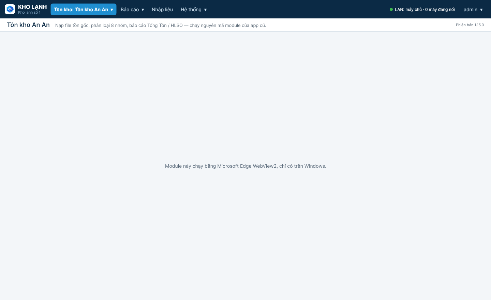
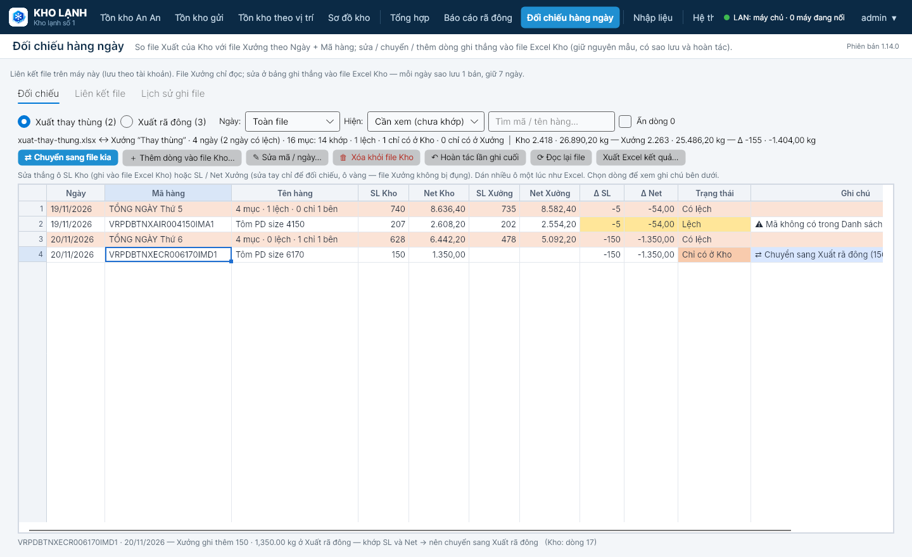

# Kho Lạnh C#

Phần mềm quản lý kho lạnh chạy trên Windows, viết bằng C# (.NET 8, giao diện Avalonia), dữ liệu SQLite cục bộ.
Đây là phần mềm **mới, tách riêng**: không dùng chung dữ liệu và không ảnh hưởng tới phần mềm kho cũ.



## Module hiện có

App đang được dựng lại theo từng module (từ bản 1.7.0 đã gỡ các module phiếu / tồn / sổ kho / báo cáo / danh mục của bản 1.0).

| Nhóm | Chức năng |
|---|---|
| Tồn kho An An | Nhúng nguyên module của app cũ (WebView2): nạp file tồn gốc, phân loại, báo cáo Tổng Tồn / HLSO. Xem `web/NGUON.md`. |
| Tồn kho gửi | Nhúng nguyên module của app cũ: nạp file tồn kho gửi, phân loại, phiếu xuất, Đặc tính. |
| Tồn kho theo vị trí | Viết bằng C# (không WebView2), theo “Tồn Vị Trí An An” của app cũ, dùng chung dữ liệu (db `ton-vi-tri-an-an`). Nạp file Tồn kho theo vị trí (tự tìm dòng tiêu đề), tìm nhanh + lọc theo khu. Gõ / dán SL xuất ngay trên lưới (“x” = lấy hết ô), khung “Phiếu đang soạn” bên phải: loại phiếu (thay thùng / xuất xả), ngày, tiêu đề, gộp theo Size, cảnh báo (còn hàng ở vị trí khác, SL bất thường, trùng phiếu cùng ngày). Lưu phiếu trừ tồn ngay; sửa, hủy trừ / trừ lại, gộp / tách phiếu, tách mã ra phiếu mới, đổi loại / ngày, xóa (hoàn tồn), mở khóa phiếu đợt nạp cũ. Nạp file mới: đối chiếu phiếu đã trừ với file mới (khớp / chưa giảm / lệch), trừ lại phiếu hôm nay, liệt kê hàng đổi vị trí. Lưu trữ theo ngày (gộp theo ngày + loại), thống kê Size, xuất Excel theo mẫu cũ và ảnh PNG. Chưa làm: nhận phiếu từ điện thoại, PDF, in trực tiếp. |
| Tổng hợp | Viết bằng C# (không WebView2), dùng chung dữ liệu với app cũ (db `tong-hop`). Mã hóa sản phẩm 21 ký tự (10 tổ hợp, danh sách chuẩn), danh sách mã hàng (11.603 mã mặc định, tô đỏ mã sai độ dài, tô vàng mã trùng / tổ hợp chưa khai báo, ghép mã), Bảng 1 nhập từ Excel → Bảng 2 gộp theo Ngày + Tên sản phẩm + Size, ánh xạ tên hàng (quy tắc đơn, kết hợp). Chưa làm: Tra cứu kháng sinh. |
| Báo cáo rã đông | Viết bằng C# (không WebView2), dùng chung dữ liệu với app cũ (db `bao-cao-ra-dong`). Nạp file báo cáo kho (tự tìm dòng tiêu đề, bỏ tiền tố TPC-), Bảng 2 gộp theo Ngày + Tên sản phẩm + Size (Net thiếu tự tính, sửa tay, bảng chưa gộp, hoàn tác), Bảng 3 lưu theo ngày (thay thế / cập nhật giữ dòng sửa tay / cộng dồn, hoàn tác cập nhật), Excel năm theo mẫu, ảnh bảng ngày. Nút “Lấy từ Đối chiếu hàng ngày” (cập nhật Bảng 3 từ file Xuất rã đông đã liên kết) và “Kiểm ngày thiếu”. |
| Đối chiếu hàng ngày | Viết bằng C# (không WebView2), theo M16 của app cũ. Liên kết 3 file Excel trên máy (lưu theo tài khoản): Xuất thay thùng, Xuất rã đông (app ghi thẳng) và Xưởng (chỉ đọc, 2 sheet tự ghép theo số mã trùng). So theo Ngày + Mã (khớp / lệch / chỉ có ở Kho / chỉ có ở Xưởng / ghi 0), BTP / NL so nhanh theo Size + kg/thùng, gợi ý mã nằm nhầm file, nghi sai mã. Sửa SL Kho ngay trên lưới, chuyển mã giữa 2 file, thêm dòng, sửa mã / ngày, xóa, nạp file gốc của phần mềm kho (thêm ngày mới / thay ngày khác số); ghi file giữ nguyên mẫu (sửa XML trực tiếp, dòng tổng ngày = SUM), ghi cả 2 file hoặc không file nào, sao lưu 1 bản / ngày (giữ 7 ngày), lịch sử + hoàn tác. Sửa tay số Xưởng chỉ để đối chiếu. Xuất Excel kết quả. Chưa làm (so với app cũ): tab Xuất kiểm, Thêm cột Size, Cập nhật tên hàng, tra trọng lượng từ Tồn kho, “Nạp tạm”. |
| Nhập liệu | Viết bằng C# (không WebView2). Các trang dạng lưới Excel: gõ / dán thẳng từ Excel (Ctrl+C / Ctrl+V), hoàn tác, điền xuống, tự lưu, mẫu cột (Nhập kho, Xuất kho, Kiểm kê, mẫu tự lưu), nhập / xuất Excel, thùng rác. Lưới dùng chung: `src/KhoLanh.App/Controls/SheetGrid.cs` + `src/KhoLanh.Core/Grid/GridModel.cs`. |
| Tài khoản | Đăng nhập (nhớ mật khẩu, tự đăng nhập), 3 vai trò + phân quyền tới từng module. Dùng chung cho mọi máy qua Google Sheet: `docs/TAI-KHOAN-DUNG-CHUNG.md`. |
| Cập nhật | Tự kiểm tra GitHub Releases lúc mở app và mỗi 30 phút, tải ngầm, mở lại là dùng bản mới; quay lại bản trước. |
| An toàn | Tự sao lưu mỗi ngày (giữ 30 bản), sao lưu ra file, khôi phục, nhật ký thao tác. |

**Thêm module mới:** thêm `NavItem` trong `MainWindow.axaml.cs` và mục quyền trong `Perm.Items` (`src/KhoLanh.Core/Models/Permissions.cs`). Dữ liệu module đọc / ghi qua `ISheetSource` (`App.Services.Lan`) để tự đồng bộ LAN; thêm tên database vào `ModuleBridge.PermKey`.





## Dùng chung qua mạng LAN

Nhiều máy trong mạng nội bộ dùng chung dữ liệu module: máy chủ chính, máy dự phòng tự thay khi máy chủ tắt, máy con.
Mất máy chủ vẫn làm việc được, có máy chủ lại thì tự gộp. Xem [docs/MANG-LAN.md](docs/MANG-LAN.md).

## Cài đặt và chạy

1. Máy đầu tiên: tải `KhoLanh.exe` ở **Releases**. Máy tiếp theo: dùng nút **Tạo bộ cài cho máy mới** trong app.
2. Chép vào một thư mục bất kỳ, nhấp đúp để chạy. Không cần cài .NET. Sau đó app tự cập nhật.

Windows SmartScreen có thể cảnh báo vì file chưa ký số: bấm **More info › Run anyway**.

## Dữ liệu nằm ở đâu

Máy mới cài lần đầu: trước khi đăng nhập, app hỏi **nơi lưu dữ liệu** (gợi ý sẵn `%LOCALAPPDATA%\KhoLanhCS\`, nên chọn ổ dữ liệu như `D:\KhoLanhData`). Đổi lại được ở **Hệ thống › Sao lưu và cài đặt › Đổi nơi lưu dữ liệu…** (app chép dữ liệu sang rồi đóng để mở lại; thư mục cũ giữ nguyên). Máy đã dùng từ bản trước không bị hỏi.

Trong thư mục dữ liệu:
- `khodata.db` — toàn bộ dữ liệu (SQLite)
- `SaoLuu\` — bản sao lưu tự động hằng ngày

Lựa chọn được ghi ở `%LOCALAPPDATA%\KhoLanhCS\noi-luu-du-lieu.txt`. Biến môi trường `KHOLANH_DATA` (nếu đặt) được ưu tiên hơn.


## Dành cho lập trình viên

```
src/KhoLanh.Core      nghiệp vụ + SQLite (Dapper), xuất Excel (ClosedXML), mẫu in
src/KhoLanh.App       giao diện Avalonia
tests/KhoLanh.Core.Tests  kiểm thử xUnit cho nghiệp vụ
tools/Screenshots     tạo dữ liệu mẫu và chụp ảnh các màn hình (chạy không cần màn hình)
```

```bash
dotnet test tests/KhoLanh.Core.Tests
dotnet run --project src/KhoLanh.App
dotnet publish src/KhoLanh.App -c Release -r win-x64 --self-contained true -p:PublishSingleFile=true -p:IncludeNativeLibrariesForSelfExtract=true -o publish/win-x64
dotnet run --project tools/Screenshots -- docs/anh
```

Mỗi lần đẩy lên nhánh `main`, GitHub Actions tự chạy kiểm thử và đóng gói `KhoLanh.exe`. Gắn tag `v1.0.0` để tạo bản phát hành.
