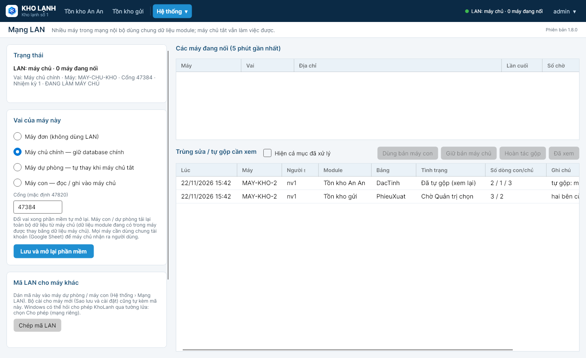

# Dùng chung dữ liệu qua mạng LAN

Từ bản 1.8.0, nhiều máy trong cùng mạng nội bộ dùng chung dữ liệu hai module Tồn kho An An và Tồn kho gửi.
Cài ở **Hệ thống › Mạng LAN** (chỉ Quản trị).

## Các vai

| Vai | Làm gì |
|---|---|
| Máy đơn | Không dùng LAN (mặc định). |
| Máy chủ chính | Giữ database chính, mở cổng 47820 cho các máy khác. |
| Máy dự phòng | Chép mọi thay đổi của máy chủ mỗi giây. Máy chủ tắt khoảng 10 giây thì tự lên làm máy chủ. |
| Máy con | Đọc và ghi thẳng vào máy đang làm máy chủ, giữ một bản sao trong máy. |

## Cài đặt

1. Mọi máy bật **Tài khoản dùng chung (Google Sheet)** để máy chủ nhận ra người dùng (xem [TAI-KHOAN-DUNG-CHUNG.md](TAI-KHOAN-DUNG-CHUNG.md)).
2. Máy chủ chính: chọn **Máy chủ chính**, bấm **Lưu và mở lại phần mềm**. Nếu Windows hỏi tường lửa, chọn **Cho phép** (mạng riêng). Bấm **Chép mã LAN**.
3. Máy dự phòng (nên có một máy luôn bật): chọn **Máy dự phòng**, dán mã LAN, lưu.
4. Các máy còn lại: chọn **Máy con**, dán mã LAN, lưu. Bộ cài cho máy mới (Sao lưu và cài đặt) tạo trên máy chủ chính đã kèm mã LAN, máy mới tự làm máy con.

Thanh menu hiện trạng thái LAN: chấm **xanh** là đang nối, chấm **cam** là đang làm riêng (mất máy chủ) hoặc đang chuyển máy chủ.

## Hai người cùng sửa một bảng

Mỗi bảng có số phiên bản. Người lưu sau, nếu bảng đã bị máy khác sửa từ lúc mở, sẽ được báo bấm **Làm mới (F5)** rồi làm lại. Không ai ghi đè dữ liệu của người khác.

## Khi máy chủ tắt

- **Có máy dự phòng:** sau khoảng 10 giây máy dự phòng lên làm máy chủ (khi quá nửa số máy con cũng báo mất máy chủ). Các máy con tự chuyển sang. Máy chủ chính bật lại thì chép phần thiếu rồi nhận lại vai.
- **Không máy nào làm chủ được:** mỗi máy làm tiếp trên dữ liệu của mình, mọi lần lưu ghi vào **sổ chờ** (kèm bản gốc lúc bắt đầu sửa). Có máy chủ lại thì tự gửi lên:
  - chỉ một bên sửa bảng: lấy luôn bản đã sửa;
  - hai bên sửa khác dòng: tự gộp (vẫn ghi lại để Quản trị xem, có nút **Hoàn tác gộp**);
  - hai bên sửa cùng một dòng, hoặc một bên nạp lại cả bảng: giữ bản máy chủ, bản của máy con nằm trong danh sách **Trùng sửa** để Quản trị chọn **Dùng bản máy con** hoặc **Giữ bản máy chủ**.
- **Hai máy cùng làm máy chủ** (đứt mạng giữa hai nhóm): khi thấy nhau, máy có nhiệm kỳ thấp hơn nhường vai và gửi phần đã sửa lên để gộp như trên.

Lời khuyên: trong lúc mất máy chủ, mỗi module chỉ nên để một máy nạp file.

## Lưu ý

- Khôi phục từ file sao lưu chỉ làm được ở Máy đơn (chuyển về Máy đơn, khôi phục, rồi cài lại vai).
- Đổi địa chỉ IP của máy chủ chính thì chép lại mã LAN cho các máy (máy con vẫn nhớ địa chỉ máy dự phòng).
