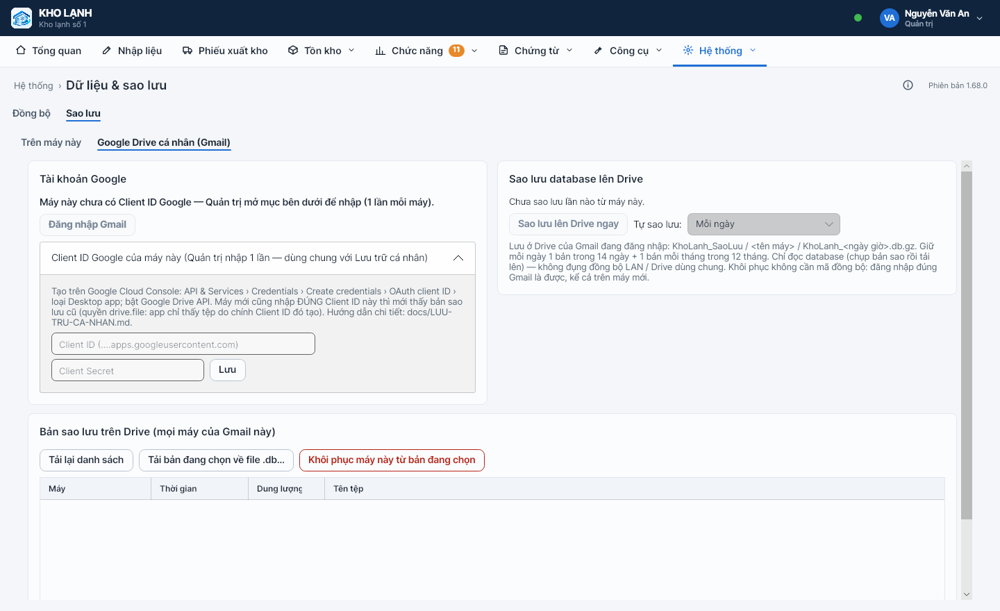

# Sao lưu lên Google Drive cá nhân (đăng nhập Gmail) — từ bản 1.68

Ở **Hệ thống › Dữ liệu & sao lưu › Sao lưu › Google Drive cá nhân (Gmail)**.

## Dùng làm gì
- Giữ thêm một bản database **ngoài máy** (máy hỏng / mất vẫn còn), trên Google Drive của chính bạn.
- Bật được với mọi cách đồng bộ, kể cả **máy chủ LAN**: chỉ chép dữ liệu ra, không đụng database chính.
- Khôi phục **không cần mã đồng bộ**: đăng nhập đúng Gmail là thấy và khôi phục được, kể cả trên máy mới.

## Cài lần đầu (Quản trị, mỗi máy 1 lần)
1. Google Cloud Console › API & Services › bật **Google Drive API**; Credentials › Create credentials › **OAuth client ID**, loại **Desktop app**
   (giống Lưu trữ cá nhân — xem `LUU-TRU-CA-NHAN.md`; hai chức năng dùng chung Client ID).
2. Trong app: mở mục *Client ID Google của máy này*, dán Client ID + Client Secret, **Lưu**.
3. Máy khác / máy mới: nhập **đúng Client ID đó** (quyền `drive.file`: app chỉ thấy tệp do chính Client ID đó tạo).

## Hằng ngày
- **Đăng nhập Gmail** → trình duyệt mở trang Google → chọn tài khoản, tick quyền Drive → quay lại app.
- **Sao lưu lên Drive ngay**, hoặc chọn **Tự sao lưu** (mỗi giờ / 3 / 6 / 12 giờ / mỗi ngày — app kiểm tra mỗi phút khi đang mở).
- Tệp lưu ở `KhoLanh_SaoLuu / <tên máy> / KhoLanh_<ngày giờ>.db.gz`; giữ mỗi ngày 1 bản trong 14 ngày + 1 bản mỗi tháng trong 12 tháng.
- Chỉ máy **giữ dữ liệu chính** sao lưu / khôi phục (máy đơn, máy chủ LAN). Máy con LAN, máy xem từ xa: làm trên máy chủ / máy chính.

## Khôi phục
- Danh sách *Bản sao lưu trên Drive* hiện bản của **mọi máy** dùng Gmail này. Chọn bản → **Khôi phục máy này từ bản đang chọn** (Quản trị)
  hoặc **Tải bản đang chọn về file .db…** để tự giữ.
- Trước khi ghi đè, app tự chụp dữ liệu hiện tại vào thư mục `SaoLuu` (`truoc-khoi-phuc_…`). Xong phải đăng nhập lại.
- Máy đang bật LAN: chuyển về *Chỉ trên máy này* rồi mở lại phần mềm trước khi khôi phục (như khôi phục từ file).
